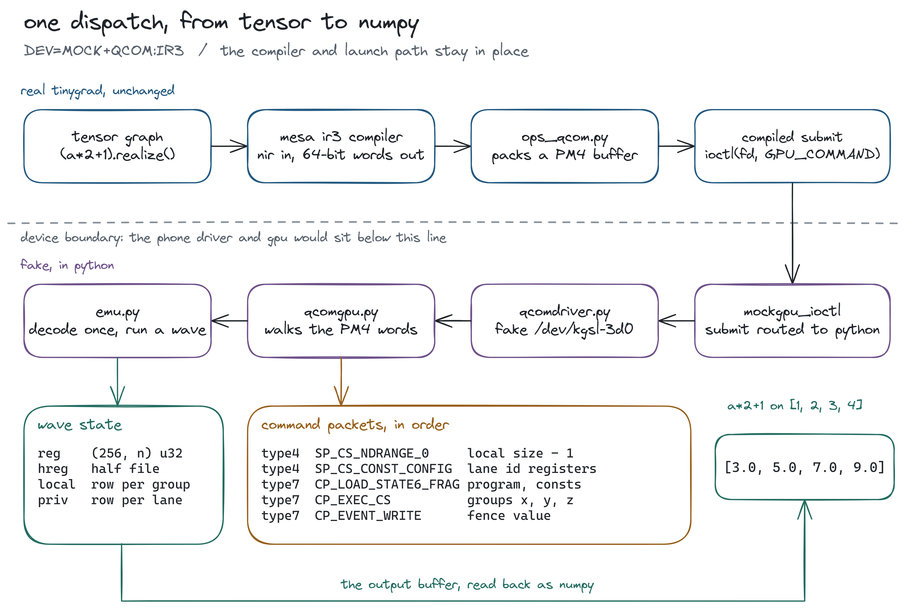
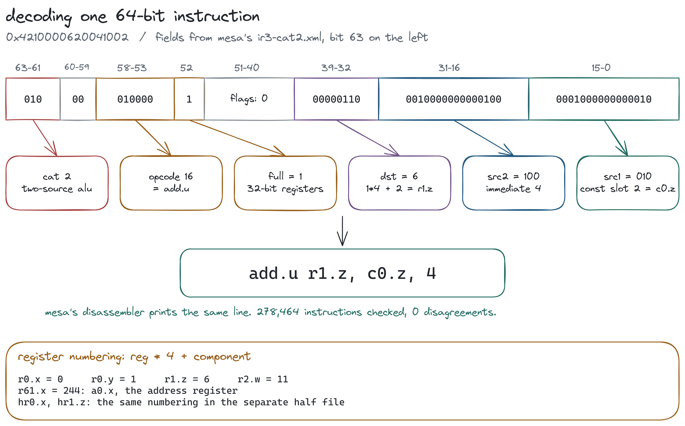
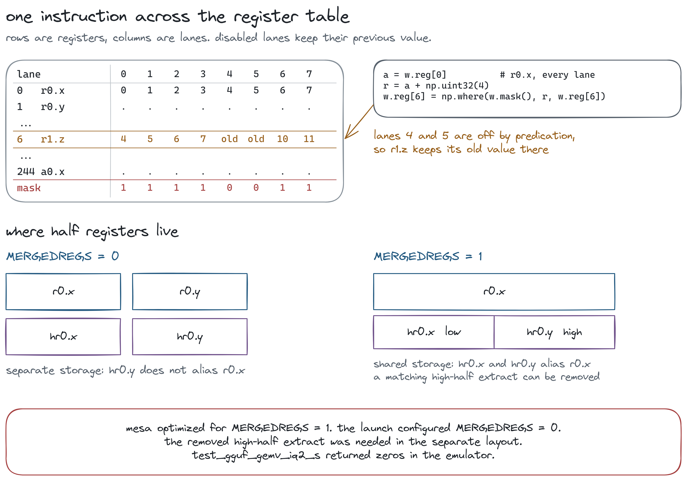
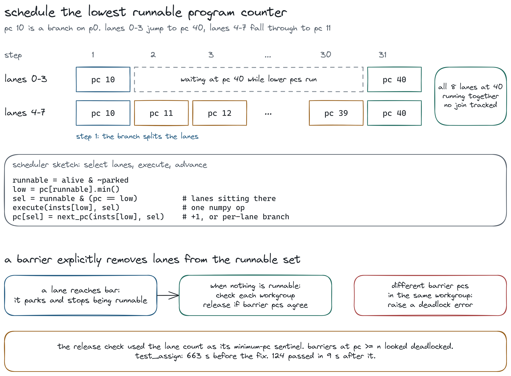

tinygrad has a backend for qualcomm phones, but there is no qualcomm phone in its ci, so every change to `ops_qcom.py` gets merged without anyone running it. there's a $500 bounty for an emulator of the adreno 630, the gpu inside a snapdragon 845, that could fill that gap. i picked it because i wanted to understand what happened between compiling a kernel and getting an answer back.

the obvious problem was that i didn't own an a630. my snapdragon laptop has a newer adreno, runs windows, has no `/dev/kgsl-3d0`, and compiles through qualcomm's own opencl compiler instead of mesa, so running anything on it would tell me nothing about tinygrad's a630 path. i decided to keep tinygrad completely untouched and build the device it expected to find instead: a fake kernel driver, a fake command processor, and a shader executor written in numpy.

my first full run of `test_ops.py` against it finished with 163 passed and 281 failed, and most of the failures claimed the gpu had hung. there was no gpu, of course. that run ended up teaching me most of what follows.

## how tinygrad talks to a phone

on a phone, tinygrad never touches a graphics api. it opens `/dev/kgsl-3d0`, which is qualcomm's linux kernel driver, and talks to it through `ioctl`, a system call where a request number picks the operation and a pointer says where its arguments live. the whole conversation is ten requests: ask what the chip is, create a context, allocate and free memory, submit work, and ask how far the work got. my fake driver answers each of them by writing a ctypes struct at the address tinygrad passed in, so when tinygrad asks for the chip, it gets back `chip_id = 0x06030001`, which is adreno 6.3.0.1.

one detail made the whole project much simpler. tinygrad allocates its buffers with `KGSL_MEMFLAGS_USE_CPU_MAP`, which means a buffer's gpu address is the same number as its cpu address. so when a shader later says "load from 0x7f3a12340000", the emulator can simply read that address in its own python process. it only has to check first that the address falls inside a buffer it handed out, because anything else would either crash python or quietly read garbage. that check, as it turned out later, is what made the emulator good at finding bugs.

the actual work arrives through the `GPU_COMMAND` request as PM4, the language of the gpu's command processor. the command processor is a small core that sits in front of the shader cores and reads a flat list of 32-bit words, where each packet begins with a header saying what kind of packet it is and how many words follow. only two kinds matter here: a type4 packet writes a run of consecutive registers, and a type7 packet is a command. my whole reader is this loop:

```python
hdr = words[pc]
if hdr >> 28 == 4: cnt, reg, op = hdr & 0x7f, (hdr >> 8) & 0x3ffff, -1
elif hdr >> 28 == 7: cnt, reg, op = hdr & 0x3fff, 0, (hdr >> 16) & 0x7f
else: raise RuntimeError(f"PM4 header {hdr:#010x} at word {pc}")
payload, pc = words[pc + 1:pc + 1 + cnt], pc + 1 + cnt
if op == -1: self.regs.update((reg + i, v) for i, v in enumerate(payload))
```

the top four bits give the packet type. a type4 header keeps its count in the low 7 bits and the first register in bits 8 to 25, while a type7 header keeps its count in the low 14 bits and the opcode in bits 16 to 22. register writes go into a dict, since on real hardware registers are just state that later packets read.

launching a kernel takes a handful of these packets. `SP_CS_NDRANGE_0` holds the workgroup size minus one, `SP_CS_CONST_CONFIG` says which registers the shader expects its ids in, `CP_LOAD_STATE6_FRAG` points at the shader binary and its constants, and `CP_EXEC_CS` carries the number of workgroups and means go. a workgroup here is a group of invocations that can share local memory and wait for each other at barriers. finally `CP_EVENT_WRITE` writes a fence value into memory, which is simply a completion marker the host waits for before it reads the output.



in the figure, the top row is real tinygrad and the second row is everything i wrote. a tensor expression like `a * 2 + 1` goes through mesa's compiler, `ops_qcom.py` packs it into PM4, and a compiled submit calls `ioctl`. below the dashed line, where a phone's driver and gpu would normally sit, my driver hands the PM4 to my command processor, which reads the packets listed under "command packets, in order" and finally calls the emulator. the emulator's entire state fits in the "wave state" box, and what comes back for `[1, 2, 3, 4]` is `[3.0, 5.0, 7.0, 9.0]`.

the first real problem had nothing to do with gpus at all. tinygrad's other mock gpus catch `ioctl` at the python layer, so i wired my driver in the same way, and nothing happened. the context request arrived, the allocations arrived, but not a single `GPU_COMMAND`. the reason was that hcq2, tinygrad's hardware queue code, compiles the whole launch path into a small c program, and that program calls libc's `ioctl` directly, so python never sees the submit. the fix that lives in the code now is one rewrite rule in `mockgpu.py`, which swaps that call for `mockgpu_ioctl` before the c is compiled, so the generated program calls straight into my driver.

running inside generated c caused two more problems. my driver first queued submits and ran them on the next `ioctl`, the way a real gpu works in the background, and the jit tests deadlocked. hcq2's generated code submits and then polls the fence in memory without ever making another call, so nothing drained my queue. a phone's gpu keeps going on its own, but an emulator only gets control during the submit itself, so work now runs inside `GPU_COMMAND` and the fence is written before the call returns.

the second problem explains those 281 failures. a python exception can't unwind through c frames, so ctypes prints it and returns as if nothing happened. the fence never gets written, the test polls forever, and under pytest-xdist that worker reports "QCOM hang detected" for every test it runs afterwards. once i ran the suite serially with `-x`, the first real traceback showed up in seconds, and underneath all that noise there were only six actual bugs. the driver now stores the exception and raises it at the next timestamp read, which happens in plain python, so pytest gets the real error.

## reading the shader

before writing any executor, i wanted to know how much of the instruction set i actually needed. so i compiled every kernel `test_ops.py` produces for `NULL:IR3:a630`, tinygrad's compile-only device, about 1,320 kernels in all. they used only 75 distinct instructions, or 77 with `IMAGE=1`, whereas mesa's instruction spec lists 232 for this gpu. most of the difference is graphics work like interpolating vertex attributes or discarding pixels, which a compute kernel never does. so i implemented everything mesa can emit for compute, and anything else raises with the instruction's name, which means a new kernel fails loudly instead of running past something i ignored.

an ir3 instruction is 64 bits wide, and its top three bits pick a category: flow control, moves, two-source alu, three-source alu, special functions like `sin` and `rcp`, textures, memory, and barriers. each category lays out the remaining bits differently, so decoding always starts with that choice. i wrote the decoder straight from mesa's `ir3-cat*.xml` files, which describe every field the way a datasheet would.



reading the figure left to right, bits 63 to 61 are `010`, so this is a two-source alu instruction. bits 58 to 53 give opcode 16, which is `add.u`, and bit 52 says it works on full 32-bit registers. the destination field holds 6, because registers are numbered `register * 4 + component`, so `r1.z` is `1 * 4 + 2`. the two source fields carry a few extra bits saying where each value comes from: one says "constant slot 2", which is `c0.z`, and the other says "the literal 4", an immediate stored inside the instruction itself. the difference matters more than it looks. adding the slot number 2 to 4 would decode every field correctly and still compute the wrong answer.

one small table caught me out early. ir3 keeps a few common float constants built into the instruction set, like 0.5, 2, e and pi, and i had entries 7 and 8 swapped. those happen to be the two that mesa's `exp` and `log` multiply by, so every `exp` and `log` in the test suite came back as nan, and the fix was swapping two numbers back.

a decoder bug is the worst kind of bug in an emulator, because it gives you plausible wrong numbers and no error. so i checked mine against mesa's own disassembler, which tinygrad already ships: decode every instruction, print it in mesa's syntax, and compare. across 278,464 instructions from 1,697 kernels, the two agreed every time.

## a wave is a table

a gpu runs one program over thousands of lanes in lockstep, and numpy runs one operation over thousands of numbers. those are the same shape, which is the idea the whole executor rests on. the register file is a `(256, n)` array of `uint32`, with one row per register and one column per lane, so `add.u r1.z, r0.x, 4` is just row 6 equals row 0 plus 4, for every lane, in a single numpy call. the rows hold raw bits, and each instruction views them as float, signed or unsigned depending on its opcode.



the catch is that lanes don't always agree. in the top half of the figure, `r0.x` holds the lane numbers 0 to 7, so adding 4 should give 4 to 11, but lanes 4 and 5 have been switched off by predication, which lets an instruction run only where a condition holds. so the row that gets written is `4, 5, 6, 7, old, old, 10, 11`. every write in the emulator goes through `np.where(mask, new, old)`, where the mask is one true or false per lane, and that single line is all predication ever needed.

the bottom half shows a subtler problem. half-precision registers on this gpu can either live in their own file, or share the full one, so that `hr0.x` and `hr0.y` are the low and high halves of `r0.x`. a hardware bit called `MERGEDREGS` says which, and the emulator reads it. this caught a real bug: `test_gguf_gemv_iq2_s` came back all zeros, and following its registers showed a `shr.b hX, rY, 16` missing from the binary. mesa had deleted it because, with merged registers, that shift does nothing, since `hX` already is the high half of `rY`. tinygrad, however, told the gpu the registers were separate, where the shift was the whole computation. the version in my tree now takes the bit from the compiled program, so the compiler and the hardware always agree on which bits a register name means.

branches were where the first run fell apart, since four of the six real bugs were the same thing: a branch where some lanes jump and others don't. real hardware remembers where the two groups meet again with a reconvergence stack, which is exactly the kind of bookkeeping that rots in an emulator. so i gave every lane its own program counter and, at each step, ran the lowest one among the lanes that could run, for exactly the lanes sitting there:

```python
p = int(pc[run].min())
sel = run & (pc == p)
...
elif n in ("br", "brao", "braa"):
  c1 = (w.reg[REG_P0 + i.extra["comp1"]] != 0) ^ bool(i.extra["inv1"])
  c2 = (w.reg[REG_P0 + i.extra["comp2"]] != 0) ^ bool(i.extra["inv2"])
  cond = c1 if n == "br" else (c1 | c2) if n == "brao" else (c1 & c2)
  pc[sel] = np.where(cond[sel], p + i.immed, p + 1)
```



in the figure, the branch at pc 10 sends lanes 0 to 3 to pc 40 while lanes 4 to 7 fall through to pc 11. the pc array is now `[40, 40, 40, 40, 11, 11, 11, 11]`, so the minimum is 11 and only the last four lanes run. they walk up through 12, 13 and onwards while the first four sit at 40, because 40 is never the lowest. once the slower group reaches 40 too, every lane matches and they all run together again, without anything ever recording where the paths should meet. loops work for the same reason in reverse: lanes that keep looping branch back to a lower pc, so they always run first, until the last one leaves. with this in place, the second full run came back with 404 passed and 17 failed.

barriers needed one more rule. at first i treated `bar` as a no-op, since lowest-pc-first already kept lanes together in the cases i had tried. but tinygrad puts barriers inside loops, and there a fast lane can take the loop's back edge, land on a lower pc than a slow lane still finishing the previous iteration, and read shared memory before the slow lane has written it. my check kernel had lane 0 reading 0. so now a lane that reaches `bar` parks and stops being runnable, and once nothing can run, each workgroup whose lanes are all parked is released together. i promptly wrote a bug into that release, though: it looked for the lowest parked pc but started its search at the number of lanes, so any barrier past instruction n looked like a deadlock when the wave had n lanes. `test_assign` sat there for 663 seconds, and after the fix it finished 124 tests in 9.

## making it fast enough

even with the memory ranges fixed, workers kept dying with "worker crashed" and a `SIGABRT`, which looked a lot like heap corruption. there had been some, in fact: my driver never removed freed buffers from its list of valid ranges, so the bounds check kept allowing reads into memory python had already given back. but fixing that changed nothing. the answer was in tinygrad's `conftest.py`, which sends `SIGABRT` to any test that runs past `TEST_TIMEOUT`, 120 seconds by default. nothing was corrupt. the emulator was simply too slow, and a slow test dies exactly like a broken one.

at that point the full `test_ops` took about 26 minutes. vectorizing the arithmetic hadn't removed the python interpreter, which still picked a handler, read operands and advanced pcs for every instruction, and with only one small workgroup per wave, that overhead wrapped around very little arithmetic. so i started packing many workgroups into one wide wave. the hardware gives workgroups no fixed order relative to each other, so running many of them side by side is as valid a schedule as any, and once local memory became one row per workgroup, even the ones using shared memory and barriers could share a wave. the dispatch now packs up to 65,536 lanes at a time, and `sdpa_gqa`, the slowest test, went from over 120 seconds to 10.6.

the last three failures were `sin`, `cos` and `tan` on huge inputs, and they turned out to be real hardware behavior. mesa rewrites `sin(x)` as `sin(2 * pi * fract(x / (2 * pi) + 0.5) - pi)`, where `fract` keeps only the fractional part, so that the input gets folded into one period first. in float32 that folding loses precision as the input grows, so at x = 44 the rewritten formula gives 0.017699748, bit for bit what the emulator returns, while numpy's sine gives 0.017701926. a real a630 runs the same rewritten code, so i extended the existing skip for those inputs to qcom, and the run finished with 421 passed and 0 failed in 2:13, down from 26 minutes.

## the rules nobody wrote down

qualcomm publishes nothing about what these instructions actually compute, so the closest thing to a spec is mesa's compiler. it has to produce correct programs, which means the way it uses an instruction pins down what that instruction does. whenever i was unsure, i found where mesa emits the instruction and worked backwards from what the surrounding code needs.

for example, mesa builds a 32-bit multiply out of three instructions, and the sequence only adds up to `a * b` if `mull.u` multiplies just the low 16 bits of each input. similarly, mesa computes "find the highest set bit" as `31 - clz.b(x)`, and that only works for zero if `clz.b(0)` returns -1. integer saturation was another one: my first version clamped every saturating add to between 0 and 1, like the float version does, and `a % 7` on unsigned ints started returning `a`, because the compiled modulo hides a saturating add of 1 deep inside it.

i also wrote a fuzzer that generates small random tensor programs and compares the emulator bitwise against tinygrad's cpu backend. its third batch ran 600 cases, found 11 mismatches, and none of them were emulator bugs. one of them was a bug in the reference itself: a uint8 `254 + 197` cast to uint16 gave 451 on the cpu backend, while the emulator, tinygrad's python backend and numpy all gave 195. a uint8 sum is supposed to wrap at 256 before the cast, and the cpu backend's generated c promoted both numbers to int first. a disagreement only tells you that something is wrong, and tracing it to the first differing instruction is the only way to find out which side.

all of this, though, was still the compiler's model of the hardware. then i ran a test file that had also run, unchanged, on three real adreno phones, a 660, a 619 and a 615, the last of which is the same generation as the 630. my emulator passed 4 of its 12 tests.

| case | my emulator | the phones |
|---|---|---|
| denormal inputs and results | kept | flushed to a signed zero |
| `1.0 - nan` | `0xffc00000` | `0x7fc00000` |
| `max(-0.0, 0.0)` | depended on argument order | +0, either order |
| mad with a tiny product | product kept | product flushed, then added |
| half `rcp` | rounded to nearest at `f16` | matched rounding toward zero on the tested inputs |
| `f32` to `f16` cast of `2^-20` | a half denormal | flushed to 0 |
| 17 images in one kernel | raised | works, the texture index comes from a register |

none of these show up in mesa's code, because the compiler never needs to know what the alu does with a denormal or which nan it produces. denormals are the tiny floats below the smallest normal number, around 1.18e-38 in float32, and this alu turns every one of them into zero, keeping its sign:

```python
def _ftz(v:np.ndarray) -> np.ndarray:
  if v.dtype.kind != "f" or not (m := np.abs(v) < np.finfo(v.dtype).tiny).any(): return v
  return np.where(m, np.copysign(v.dtype.type(0), v), v)
```

the sign is the important detail, since the phones return -0.0 for -1e-39 times 1.5. nan, meanwhile, is a whole family of bit patterns rather than one value. mesa compiles `1.0 - x` as an add with a negated input, and negating a nan in numpy flips its sign bit, which is why my emulator returned `0xffc00000` while the phones always return the positive `0x7fc00000`. the multiply-add rounds and flushes its product before adding, so a tiny half-precision product of 2^-16 simply vanishes next to 2^-14, which is why `mad` in the emulator is `_ftz(a * b) + c`. finally, conversions round toward zero unless an instruction asks for nearest-even, so tinygrad's nir renderer now tells mesa to ask for it, which keeps casts on this path consistent with every other backend. once all of those rules were in, along with registers selecting the texture past 16 images, the same file passed 12 of 12.

## what it found, and what it can't prove

an emulator that checks every address ends up finding bugs nobody was looking for, and four of them were in tinygrad itself. `ops_qcom` bound a kernel's buffers by their position in its compacted argument list instead of the original call, so a kernel using buffers 0 and 2 received 0 and 1, and `t[1] += 2; t[1] -= 1` gave `[[0, 1], [4, 5]]` instead of `[[0, 1], [3, 4]]`. that one merged as #18288 after it was checked on a real device. the nir renderer had marked every global load as safe to reorder, so mesa reused a stale accumulator across the stores that changed it, and `test_sum` returned 5 instead of 15 (#18356). past 2048 bytes of constants, `ops_qcom` wrote image descriptors right over them (#18440), and a symbolic launch size crashed a dimension check (#18441). those last three were closed, and for a good reason: a bug fix needs a test that fails without the tool that found it.

on tinygrad master as of oct 31, the full `test/runtime` and `test/device/qcom` suites, run file by file, gave 1,983 passed, 6 failed and 2 errors. six of those eight were my machine, which was missing two python packages and had a torch version that rejects a pad even on plain cpu. the other two were `log2` of a half-precision denormal coming back as `-inf`, because the input gets flushed to zero first, which is the phone rule applied to a case no phone has actually run.

no a630 has executed a single byte of any of this. the phone results come from a 615, a 619 and a 660, and a handful of rules still rest only on what qualcomm's opencl compiler emits. the whole emulator is about 900 lines on a local branch.

i started this wanting to understand what happens between compiling a kernel and getting an answer back. the answer is ten ioctls, a handful of packets, 75 instructions, a table of registers and a pile of rounding rules, and every one of them had to be right before `[1, 2, 3, 4]` came back as `[3.0, 5.0, 7.0, 9.0]`.

thanks for reading.
