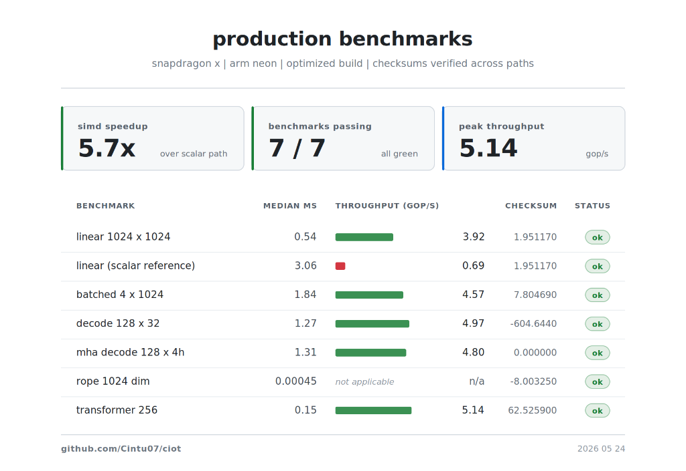

ciot runs ternary neural networks on a cpu. it's one c++ binary with no dependencies. you point it at a `.bits` file and it produces tokens, and nothing like pytorch or cuda has to be installed first. on my snapdragon x laptop a 1024x1024 ternary matrix-vector product takes 0.54 ms, about 5.7 times faster than a careful scalar version of the same loop. the code is on github at [cintu07/ciot](https://github.com/Cintu07/ciot), and it's about 3,000 lines of c++ and python.

i wanted to know how fast ternary weights could really run on a laptop i own if i took the framework overhead seriously and got rid of it. the kernel turned out to be the smaller part of the job. once the matvec was fast and correct, i still needed a tokenizer, a model loader, a kv cache, a rope table, an attention loop and a small trainer so the weights weren't random, and each of those is a place where a bad layout or a misaligned allocation can lose the speed again. the first few commits on github are roughly what i posted on twitter and linkedin. the rest came after the matvec was correct and i wanted a real model running on it.

## why ternary

a ternary weight is -1, 0 or +1. multiplying by one isn't really a multiply. it's an add, nothing, or a subtract. so a ternary matrix times a vector comes down to picking some inputs, skipping others and flipping a few signs, which a cpu does very quickly if the memory layout helps.

the bitnet 1.58b work and the papers after it show that with the right training, ternary weights lose surprisingly little accuracy compared with float32. to run them fast you need a kernel that works on the bits directly, and neither blas nor cublas has a ternary gemm. so you write your own, or you store the ternary values in float32 and give up the speed like a coward.

ciot writes its own.

three values matter more than two. a binary network, only -1 and +1, can't say that a connection doesn't matter, and most connections don't. ternary keeps a zero, and in this kernel zeros cost nothing. they don't appear in either bit plane, so they're never read at all, and the network gets the benefit of sparsity without keeping any lists of where the zeros are.

most of the published work is about accuracy, and it consistently finds the accuracy gap from float to ternary is much smaller than the storage gap. the kernel side is thinner. people benchmark simulated bit packings or fall back to int8 kernels, and few write bit-plane code for real hardware. that's the part ciot tries to do properly.

## 64 weights in 16 bytes

the layout comes first. ciot keeps two bit planes per row. one says which weights are +1, the other says which are -1, and a weight with neither bit set is zero. that's two bits per weight with nothing stored for the zeros.

a run of 64 weights is two `uint64`s. a matrix with `cols` columns has `blocks64 = ceil(cols / 64)` blocks per row, two flat arrays of `rows * blocks64` words, and one float per row for its scale.

```cpp
struct TernaryMatrix {
    std::uint32_t rows = 0;
    std::uint32_t cols = 0;
    std::uint32_t blocks64 = 0;
    std::uint64_t* pos_bits = nullptr;   // rows * blocks64
    std::uint64_t* neg_bits = nullptr;   // rows * blocks64
    float*         row_scale = nullptr;  // rows
};
```

a 1024x1024 matrix takes 1024 \* 16 \* 2 = 32 kb of bit planes and 4 kb of scales. as float32 it would be 4 mb, so this is about 113 times smaller, and it's already in the shape the simd code wants.

the `.bits` file on disk is that same layout behind a small header. there's an 8-byte magic string `CIOTBIT1`, the dimensions and `blocks64`, then the scales, `pos_bits` and `neg_bits`. the loader reads the header, checks the magic, allocates aligned memory and reads the rest with two contiguous reads. there's nothing to parse, and mmap would work just as well.

a few details took longer to get right than the kernel itself.

every allocation goes through `aligned_malloc` with 64-byte alignment, the cache line size on every cpu ciot supports. on avx-512 it isn't optional, because `_mm512_maskz_load_ps` faults on a pointer that isn't 64-byte aligned. the wrapper uses `posix_memalign` or `_aligned_malloc` depending on the platform, so the same code builds on a snapdragon laptop, a mac mini and a ryzen desktop. the constant lives in one place in `Ciot.h`.

```cpp
constexpr std::size_t CIOT_CACHELINE = 64;
constexpr std::uint32_t CIOT_TERNARY_BLOCK = 64;
```

the two 64s being the same is deliberate. one block of 64 weights is 16 bytes of bit planes, a quarter of a cache line, so four blocks fill a line and the prefetcher handles the rest.

the planes are row-major. column-major would make batches of vectors easier, but decode-time inference mostly does one row at a time, adding into one `y[r]`. row-major keeps each row's two arrays contiguous, and the inner loop reads `pos_bits[row_base + b]` and `neg_bits[row_base + b]` with an 8-byte stride, which is about as easy as memory access gets.

i also considered packing each weight into two bits of a byte, 00 for zero, 01 for +1 and 10 for -1. it's the same density, but then the kernel has to look at every weight to decide which case it is. with two planes it never makes a per-weight decision. it does the +1 work, does the -1 work and subtracts, and the zeros take care of themselves by not being in either plane. the file layout and the kernel's shape are really one decision.

## from float to ternary

round every weight of a trained float matrix to the nearest of -1, 0 and +1 and you get something that looks like the original and has lost most of what it learned. small weights all collapse to zero, big ones get clipped, and the row sums drift.

ciot's packer uses error compensation, the idea behind delta-sigma modulation. whatever gets thrown away when one weight is rounded is carried into the next weight before that one is rounded. a row full of small positive values doesn't vanish, because every few weights the carried residual crosses the threshold and comes out as a +1.

the packer is plain python with only the standard library, and the quantizer is one function.

```python
def quantize_row_error_compensated(row):
    scale = sum(abs(v) for v in row) / len(row)
    threshold = 0.5 * scale
    carry = 0.0
    quantized = []
    for value in row:
        adjusted = value + carry
        if adjusted >  threshold: q =  1
        elif adjusted < -threshold: q = -1
        else: q = 0
        carry = adjusted - (q * scale)
        quantized.append(q)
    return scale, quantized
```

each row's scale `s` is the mean absolute value of the row, a weight needs to pass `0.5 * s` to become nonzero, and the leftover `value + carry - q*s` moves on to the next column.

the scale is the one place the format gives back precision. the kernel multiplies each row's result by `row_scale[r]` to recover the size that -1, 0 and +1 can't express. it's one float per row, 4 kb for a 1024x1024 matrix next to 32 kb of bits, and it buys back enough range that the matrix behaves like the original.

half the scale is the threshold for a plain reason. a value of exactly `s` is one whole step and should become ±1, a value of zero should stay zero, and `0.5 * s` is halfway between. you could move it to make matrices sparser or denser, but if weights are spread roughly evenly between `-s` and `+s`, the midpoint is the most likely right answer.

the scale is per row instead of per matrix on purpose. rows of a trained transformer matrix differ a lot. the q, k and v projections grow attention heads, and a head shows up in the weights as a band of rows with its own magnitude. one scale for the whole matrix would flatten some bands and blow up others. per-row scales let each band keep its own range, for 4 kb.

ternary can't tell apart weights of similar size. `+0.21` and `+0.27` both become `+1`. for some layers that matters, the lm head most of all, and the fix is to train with ternary in mind. the included trainer does that in the simplest way possible, plain sgd with no schedule, and still gets reasonable behaviour out of small models. a real ternary fine-tuning recipe would do much better.

## the kernel

there's one kernel function with three simd versions, avx-512, avx2 and neon, plus a scalar reference, all the same shape and with no data-dependent branches in the hot loop.

for each row, ciot walks along the columns 64 at a time. each 64-column block has a `uint64` of +1 bits and a `uint64` of -1 bits. it loads 4, 8 or 16 floats from the input vector, depending on the vector width, turns the matching bits into a per-lane mask, zeroes the lanes whose bit is clear, and adds the rest into one of two accumulators. at the end of the row it takes the difference of the accumulators, sums it across lanes and multiplies by the row scale. almost all of the work is in turning bits into a per-lane mask.

neon is the easiest version to follow. load four floats. copy four bits of `pos_bits` into all four lanes of an integer vector, and with `{1, 2, 4, 8}` and a compare-greater-than-zero, each lane ends up all ones if its bit was set and zero if it wasn't. a bit-select then keeps the float or replaces it with zero, and the result is added to `acc_pos`. `neg` works the same way. this is the inner loop, from `src/kernels/ternary_simd.cpp`.

```cpp
static inline float32x4_t masked_load4(const float* x, std::uint32_t offset,
                                       std::uint32_t bits,
                                       uint32x4_t lane_bits,
                                       uint32x4_t zero_u32,
                                       float32x4_t zero_f32) {
    const float32x4_t values = vld1q_f32(x + offset);
    const uint32x4_t word    = vdupq_n_u32(bits);
    const uint32x4_t active  = vcgtq_u32(vandq_u32(word, lane_bits), zero_u32);
    return vbslq_f32(active, values, zero_f32);
}

// inside the per-row loop:
for (std::uint32_t b = 0; b < full_blocks; ++b) {
    const std::uint64_t pos = matrix->pos_bits[row_base + b];
    const std::uint64_t neg = matrix->neg_bits[row_base + b];
    const std::uint32_t base = b << 6U;
    for (std::uint32_t c = 0; c < 64U; c += 4U) {
        acc_pos = vaddq_f32(acc_pos, masked_load4(x, base+c, (pos>>c)&0xFU, lane_bits, zero_u32, zero_f32));
        acc_neg = vaddq_f32(acc_neg, masked_load4(x, base+c, (neg>>c)&0xFU, lane_bits, zero_u32, zero_f32));
    }
}
```

avx2 does the same with eight lanes and the mask `{1, 2, 4, 8, 16, 32, 64, 128}`. plain avx2 has no masked float load, so the mask from `cmpgt` is and-ed with the loaded floats.

avx-512 is the neatest, because it has real mask registers and `_mm512_maskz_load_ps`. a 16-bit slice of the `uint64` goes straight into the load.

```cpp
acc_pos = _mm512_add_ps(acc_pos, _mm512_maskz_load_ps((__mmask16)((pos >>  0U) & 0xFFFFU), x + base +  0U));
acc_pos = _mm512_add_ps(acc_pos, _mm512_maskz_load_ps((__mmask16)((pos >> 16U) & 0xFFFFU), x + base + 16U));
acc_pos = _mm512_add_ps(acc_pos, _mm512_maskz_load_ps((__mmask16)((pos >> 32U) & 0xFFFFU), x + base + 32U));
acc_pos = _mm512_add_ps(acc_pos, _mm512_maskz_load_ps((__mmask16)((pos >> 48U) & 0xFFFFU), x + base + 48U));
```

four masked loads cover a 64-column block for one accumulator, eight per block in total. there are no if statements and no lookup tables in that loop, so the branch predictor has nothing to get wrong.

two accumulators are simpler than one. folding the sign in at every step, `(pos_bit - neg_bit) * x[c]` into a single sum, means both planes have to meet in every instruction and the ±1 has to be built with a subtract or an xor. with two accumulators, one only ever holds inputs whose +1 bit was set and the other inputs whose -1 bit was set. they meet once per row, at a single subtract, and each pass uses the simplest instruction available.

when a row's width isn't a multiple of 64, the last `cols % 64` columns go through the scalar loop. that's at most 63 columns, about 6% of a 1024-wide row and less on wider ones, and it runs once per row, so there's no point being clever about it.

the three versions end up the same shape, with one struct, one bit layout and one reduction at the end.

| backend | lane width | mask source | "make active" instruction | horizontal sum |
| --- | --- | --- | --- | --- |
| avx-512 | 16 | native mask register | `_mm512_maskz_load_ps` (mask is the input) | `_mm512_reduce_add_ps` |
| avx2 | 8 | float-vector `and` | `_mm256_cmpgt_epi32` then `_mm256_and_ps` | manual hsum256 |
| arm neon | 4 | bool-vector `cmpgt` | `vcgtq_u32` then `vbslq_f32` | `vaddvq_f32` on aarch64 |
| scalar | 1 | bit shift | `(uint64 >> bit) & 1` cast to int | `sum` is a `float` |

the differences mostly cancel. avx-512 skips the compare step, and neon's narrower vectors need sixteen loads per block, each of them cheaper. across the three, throughput for the same matrix lands within a factor of two, which is about what you'd expect from kernels doing the same logical work.

the simd version is picked at compile time. if the compiler sees `__AVX512F__`, the avx-512 kernel becomes `matvec_ternary_native`, if it sees `__AVX2__` the avx2 one does, and so on, so any given build contains exactly one. the only runtime choice is `CIOT_BACKEND=scalar`, which sends everything through the scalar reference instead.

```cpp
DispatchBackend selected_backend() {
    static DispatchBackend selected = []() {
        const char* forced = std::getenv("CIOT_BACKEND");
        if (forced && std::strcmp(forced, "scalar") == 0) return DispatchBackend::Scalar;
        return DispatchBackend::Native;
    }();
    return selected;
}

void matvec_ternary_simd(const TernaryMatrix* matrix, const float* x, float* y) {
    if (selected_backend() == DispatchBackend::Scalar) {
        matvec_ternary_ref(matrix, x, y);   // pure scalar loop
        return;
    }
    matvec_ternary_native(matrix, x, y);    // simd
}
```

the lambda runs once, the first time it's called, and after that the check is one load of a cached integer. picking between avx-512 and avx2 at startup with cpuid, so that one x86 binary covers both, needs each kernel compiled in its own translation unit with its own flags, and the makefile doesn't do that yet. for now you build for the cpu you have. on arm the question hardly comes up, because the cpus people use all have the same neon.

the neon kernel took an evening, and so did avx2. avx-512 took about an hour once i found out mask registers existed. what took several days was the tail handling, the alignment, applying the row scales, and the warmup in `bench_matvec`, until i could trust that the timings weren't lying to me.

## the rest of the transformer

a fast matvec isn't an inference engine yet. the pieces around it need the same care, and ciot keeps them few.

```
rmsnorm           // 6 lines
rope_table_apply  // table lookup + 2 multiplies per pair
softmax_inplace   // 2 passes, max-subtract for stability
kv_cache_append   // memcpy
mha_attention_decode    // dot products + softmax + weighted sum
transformer_block_decode_mha  // ties it all together
```

rmsnorm works out the root mean square, divides by it and multiplies by a per-element gain.

```cpp
void rmsnorm(float* out, const float* x, const float* weight, std::uint32_t n, float eps) {
    float ss = 0.0f;
    for (std::uint32_t i = 0; i < n; ++i) ss += x[i] * x[i];
    const float inv_rms = 1.0f / std::sqrt((ss / n) + eps);
    for (std::uint32_t i = 0; i < n; ++i) out[i] = x[i] * inv_rms * weight[i];
}
```

there's no batch dimension, running statistics or bias. layernorm without the mean is enough here.

rope usually worries people, since rotary embeddings need a `cos` and a `sin` for every pair of dimensions, and at decode time that runs for every layer of every token. ciot works the whole table out once, when the model loads.

```cpp
for (pos = 0; pos < max_position; ++pos)
    for (i = 0; i < even_dim; i += 2)
        table->cos[pos*even_dim + i] = std::cos(pos * pow(theta, -i/even_dim));
        // same for sin
```

applying rope is then two multiplies and an add per pair, straight from the table, with no trig in the hot path. a full 1024-dimension rotation takes 0.45 microseconds, which is nothing next to the rest of the layer. at `max_position = 64` and `dim = 256` the cos and sin tables are 64 kb each and sit in l1. at `max_position = 2048` and `dim = 1024` they're 8 mb each and spill out of l2, and ciot still keeps the table, because reading from l3 costs much less than calling `cos` in software.

the kv cache is one allocation of `2 * num_heads * max_tokens * head_dim` floats, laid out per head as `[head0_K | head0_V | head1_K | head1_V | ...]`. appending is one `memcpy` per head for keys and one for values. stored token by token instead, `[t0_h0_k, t0_h1_k, t1_h0_k, ...]`, the keys of one head would sit `num_heads * head_dim` floats apart, and the loads would be strided, wasting cache lines on other heads' keys. grouped by head, the dot-product loop walks straight through memory and the hardware prefetcher does the rest, so there's no software prefetch in this code. the cache never grows. past `max_tokens` it stops appending and the model works with the prefix it has, which is what you want on a fixed context budget.

attention is ordinary scaled dot-product with a causal mask. it's `mha_attention_decode` in `src/model/mha_cache.cpp`, about thirty lines.

```cpp
for (h = 0; h < num_heads; ++h) {
    const float* keys   = cache->buffer + 2*h * max_tokens * head_dim;
    const float* values = keys + max_tokens * head_dim;
    const float* q      = query + h * head_dim;
    float* scores       = score_scratch + h * max_tokens;

    for (t = 0; t < used; ++t) {
        const float* k = keys + t * head_dim;
        float dot = 0.0f;
        for (i = 0; i < head_dim; ++i) dot += q[i] * k[i];
        scores[t] = dot * scale;
    }
    softmax_inplace(scores, used);

    float* out = attn_out + h * head_dim;
    for (i = 0; i < head_dim; ++i) out[i] = 0.0f;
    for (t = 0; t < used; ++t)
        for (i = 0; i < head_dim; ++i)
            out[i] += scores[t] * values[t*head_dim + i];
}
```

each head runs three loops, all straight walks through memory. the softmax in the middle makes one pass to find the maximum, for numerical stability, and one to exponentiate and normalise.

a whole decode layer, `transformer_block_decode_mha` in `src/model/tiny_transformer.cpp`, is rmsnorm, the q, k and v projections, rope on q and k, appending to the cache, attention, the output projection, a residual add, rmsnorm again, a relu feed-forward and another residual add. that's six ternary matvecs per layer, four for attention and two for the feed-forward. everything between them is float arithmetic on vectors of length `dim`, which grows linearly, while the matvecs grow with `dim * dim`, so the matvecs are where the time goes. that's why a whole 256-wide transformer block takes 0.15 ms while one bare 1024x1024 matvec takes 0.54. the block's six matvecs are each 256x256, and together with the attention they cost about a third of one big matvec.

## checking it's right

the easiest way to make a fast kernel give wrong answers is not to check, and ciot's check is that scalar reference behind `CIOT_BACKEND=scalar`. it loops over rows and columns, reads each weight's sign from the two planes, multiplies and adds, and it's simple enough that a subtle bug in it would be hard to write.

```cpp
for (r = 0; r < matrix->rows; ++r) {
    float sum = 0.0f;
    for (c = 0; c < matrix->cols; ++c) {
        // decode the ternary value via the bit planes
        const std::uint32_t block = c >> 6U;
        const std::uint64_t mask  = 1ULL << (c & 63U);
        const int sign = ((pos[row_base + block] & mask) != 0)
                       - ((neg[row_base + block] & mask) != 0);
        sum += sign * x[c];
    }
    y[r] = sum * row_scale[r];
}
```

every benchmark prints a checksum, `sum(y)`, next to its timing. if the simd checksum differs from the scalar one for the same matrix and input, the simd path is broken. all three simd versions print exactly the scalar checksum, `1.951170` for the 1024x1024 benchmark. the speed comes from the cpu doing less work, not from cutting corners on the arithmetic. summing `y` also stops the compiler from deleting the benchmark, which it will happily do if nothing reads the output.

the checksums match exactly because the order of operations is kept the same. floating-point addition isn't associative, so `(a + b) + c` can differ from `a + (b + c)` in the last bit, and vector accumulators change the order by nature. ciot accumulates lane by lane in the same logical order as the scalar loop and reduces at the end with a fixed tree, `vaddvq` on neon, `_mm512_reduce_add_ps` on avx-512 and a cascade of `_mm_hadd_ps` on avx2, so every run on every backend lands on the same bits. different cpus could still differ in the lowest bits, which would matter for a research result. for an inference engine, what matters is that the simd path has no systematic bias relative to the reference, and the matching checksum shows that.

a sum can't catch two swapped outputs that happen to cancel. real bit-plane bugs never seem to do that, since they change magnitudes, but the test suite also compares every element against the reference with a tolerance. the readme shows only the checksum because it's the clearest single number, and a broken kernel almost always shows up there as something wildly different.

## the numbers

every number here comes from `--bench-linear-pro` and its siblings in the repo, with 20 warmup iterations and 9 repeats. the median is the headline, the p95 shows thermal throttling, and the checksum shows nothing was skipped.

on snapdragon x, the linear matvec is 5.7 times faster than the scalar path. the rest of the table is below.



across sizes of 256, 512, 1024 and 2048, throughput stays between 7.9 and 8.8 gop/s, while the matrix goes from fitting in l1 to barely fitting in l3, without the kernel falling off a cliff. the bit planes help, since a whole 1024x1024 matrix is 36 kb. the multi-head decode block runs at the same speed as the single-head one, because the heads share one attention shape and the matvecs dominate either way. the scalar baseline is the same `-O3 -march=native` binary, matrix, input and checksum, decoding one bit at a time instead of 64.

throughput is reported as "logical gop/s", counting each ternary multiply-add as two operations the way a dense float gemm would. ciot's real cost per ternary multiply-add is nearer a third of a float one, but counting it that way would inflate the numbers without making them comparable to anything, and the convention lets you hold `--bench-suite` next to a cublas number and talk about it fairly.

the harness runs 200 matvecs per repeat and 9 repeats for the headline benchmark, 1,800 in all, and reports the median, minimum, p95 and maximum per repeat. there's no mean, because a single bad sample, a context switch or an interrupt, moves a mean and doesn't move a median. throttling hides from the median and shows up in the p95, and if the p95 is more than twice the median, the cpu is throttling.

the readme has the commands for the snapdragon numbers. on x86, build with `make avx2` or `make avx512`. on a recent intel laptop the avx-512 kernel lands between 0.3 and 0.5 ms, depending on which power state the cpu is in when the benchmark starts. warm it up first, plug the laptop in and close your browser tabs.

## the python side

the only other language in the repo is python, standard library only, with no numpy or pytorch.

- `scripts/pack_ternary.py`, about 130 lines, packs float32 weights into `.bits` with the error compensation above.
- `scripts/train_tiny_transformer.py`, about 1,200 lines, is a transformer trainer in plain python. it has a word-level tokenizer, causal multi-head attention with full forward and backward passes, rmsnorm with its gradient, sgd with gradient clipping, per-row ternary quantization with error compensation, and export to `.bits`.
- `scripts/run_tests.py` builds the binary, runs every benchmark, compares simd with scalar, checks the checksums and writes a csv.

the trainer won't produce a useful model. the architecture is tiny on purpose and sgd is the wrong optimiser for it. what it shows is that the whole pipeline connects. text goes in at one end, python trains it and quantizes the weights to ternary, and the c++ loop produces tokens at the other end. that end-to-end part is what i added after the first social media posts. before it, the c++ side could only time synthetic weights. now it loads a trained model directory and writes text.

keeping python to the standard library was deliberate too. ciot is one binary, and the tools that make its inputs shouldn't need a 2 gb pip install. the trainer is slow, matrix maths on python lists with no fma anywhere, but you can read every line. if you outgrow it, the `.bits` format is documented in the header and about thirty lines of pytorch will write one.

`scripts/run_tests.py` is what makes the readme's numbers checkable. it builds a fresh binary, runs every benchmark, records the simd results, reruns the headline matvec with `CIOT_BACKEND=scalar` and compares the checksums. it writes a csv to `data/` and a report to the terminal, and if the comparison passes on your machine, the kernel works on your machine.

## what i'd change

anything that doesn't help run ternary weights faster stays outside the core, in a python script. there are four things i still want to do.

x86 should pick between avx-512 and avx2 at startup with cpuid, so one binary covers both. that's mostly a build problem.

`matmat_ternary_simd` currently runs the single-vector kernel once per item in the batch. a real batched kernel would load each weight row once and reuse it for the whole batch from registers.

the bpe tokenizer handles ascii and stumbles on unicode. fixing it means a byte-level bpe table with proper utf-8 handling, not patching the current code.

in `--model-generate`, the embedding step uses a one-hot vector for the token instead of looking it up in the trained `embed` matrix, so trained models lose about half of what they can express. that one is a day's work.

i wouldn't change the file format or the kernel's shape, since those are what make it fast and checkable.

to try it, the hero benchmark prints checksum `1.951170` on every supported cpu. reading the code in order means starting with `src/kernels/ternary_simd.cpp`, then `src/model/model_loader.cpp`, then `src/main.cpp`.

```
git clone https://github.com/Cintu07/ciot
cd ciot && make
./bin/ciot --bench-linear-pro 1024 1024 200 9 20
```
