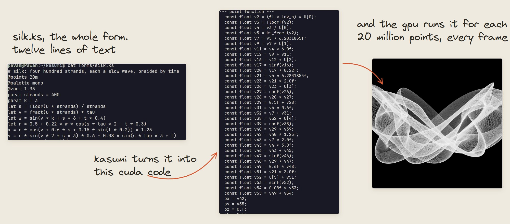
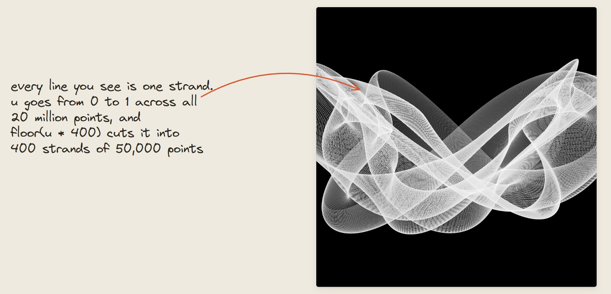
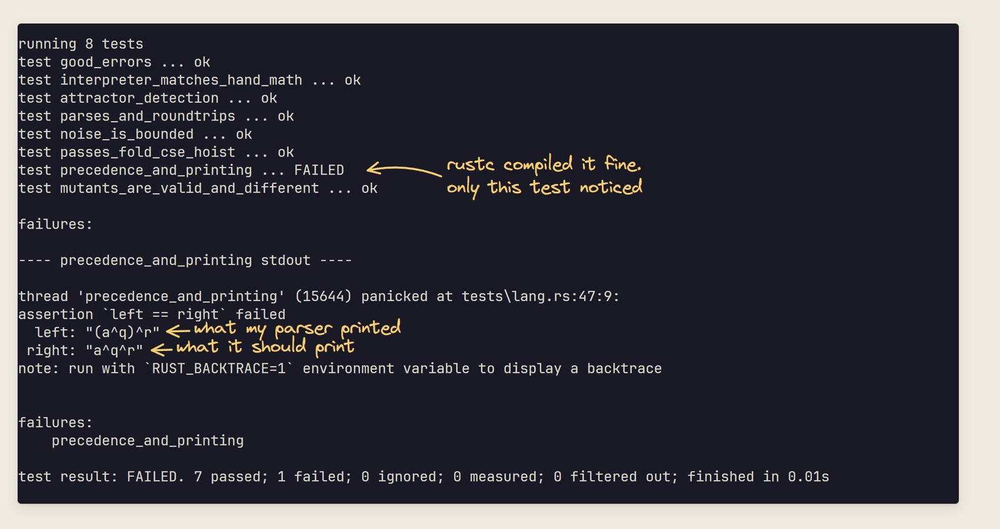
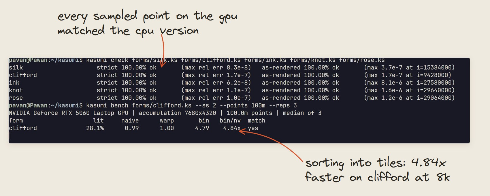
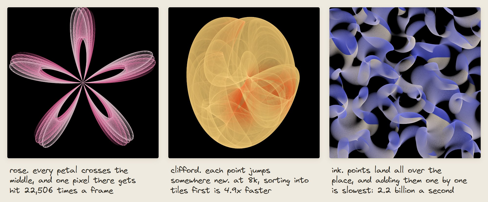
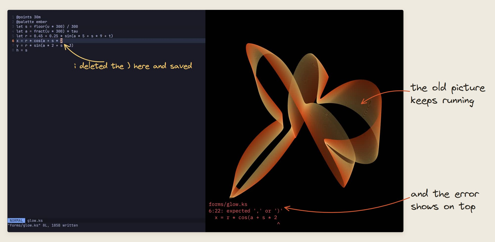
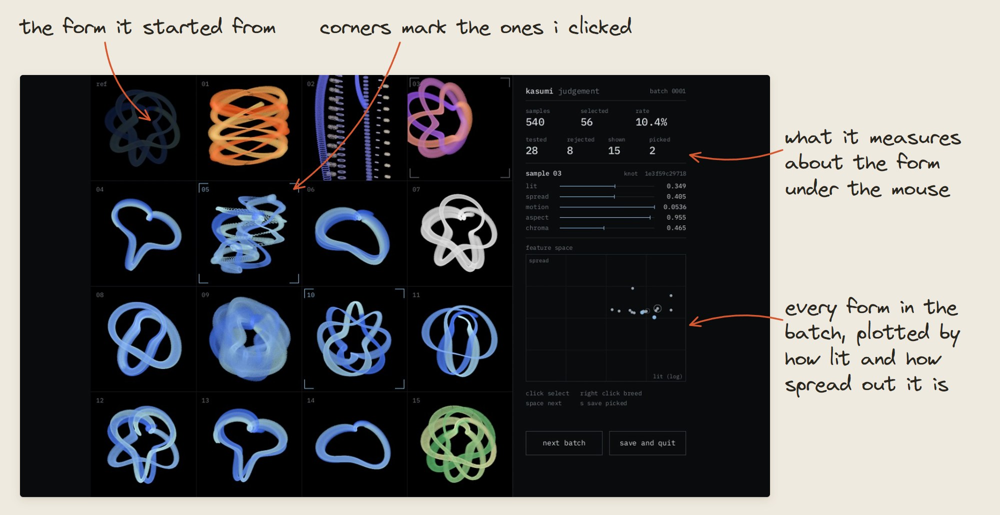
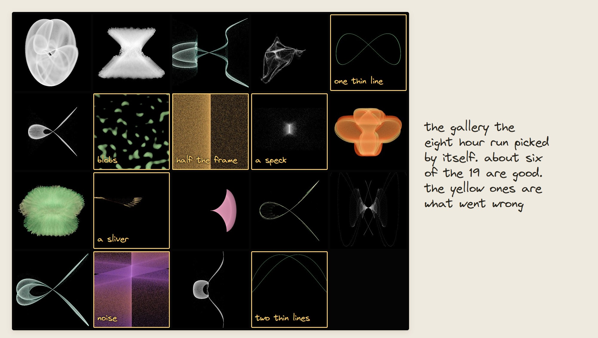
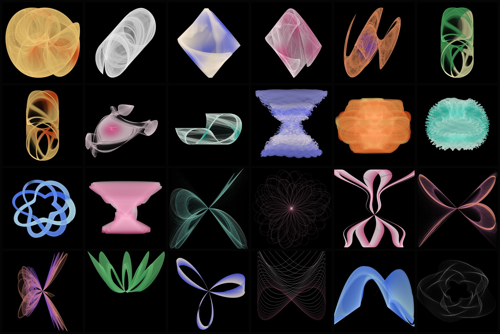

kasumi is a program i wrote that draws pictures from math. you write a few lines like `x = cos(u * tau)` in a text file, kasumi runs those lines for millions of points, and it puts a dot of light wherever each point lands. where a lot of points land on the same pixel, that pixel gets brighter. that's the whole idea, and everything below is about doing it fast enough to watch it move.

it runs on my laptop's graphics card, an rtx 5060. a graphics card has thousands of small cores that all run the same little program at once, each on different data. that fits this well, because every point runs the same lines of math with a different number plugged in. silk, the form in the picture below, draws twenty million points a frame and still runs at sixty frames a second.



## what a form is

i call the text file a form. this is silk, all twelve lines of it:

```text
# silk: four hundred strands, each a slow wave, braided by time
@points 20m
@palette mono
@zoom 1.35
param strands = 400
param k = 3
let s = floor(u * strands) / strands
let v = fract(u * strands) * tau
let w = sin(v * k + s * 6 + t * 0.4)
let r = 0.5 + 0.22 * w * cos(s * tau * 2 - t * 0.3)
x = r * cos(v + 0.6 * s + 0.15 * sin(t * 0.2)) * 1.25
y = r * sin(v * 2 + s * 3) * 0.6 + 0.08 * sin(s * tau * 3 + t)
```

a few names are always there. `u` is the point's number divided by how many points there are, so the first point has `u = 0` and the last one has `u` close to 1. `t` is the time in seconds, which is what makes it move. the form has to say where the point goes with `x` and `y`, and it can also set its brightness or its colour.

so `floor(u * 400)` cuts the twenty million points into 400 groups of 50,000. each group is one strand, and `fract(u * 400)` says how far along its strand a point is.



a form can also read `px` and `py`, the point before it. then every point is worked out from the previous one, which is how strange attractors like clifford work.

the language has no loops and no memory. every line does one thing. that keeps it small, and it means every form can become one plain run of arithmetic on the gpu.

## turning text into a gpu program

the gpu can't read my text files, so kasumi has to turn each form into real gpu code. it does that in three steps.

first it reads each line and works out its structure. `1 + 2 * 3` has to mean `1 + (2 * 3)`, and that's decided by a small table that says how hard each operator holds on to the numbers next to it:

```rust
Tok::Plus => (BinOp::Add, 10, 11),
Tok::Star => (BinOp::Mul, 20, 21),
Tok::Caret => (BinOp::Pow, 41, 40),
```

`*` has bigger numbers than `+`, so it grabs the `2` first. `^` is the odd one. its left number is bigger than its right one, which makes `2 ^ 3 ^ 2` mean `2 ^ (3 ^ 2)`, like in maths class. i swapped those two numbers on purpose while filming a video of the code going in. rust compiled it without a complaint, and one test failed:



second, kasumi flattens the form into a list of small steps, like `v7 = v3 * v5`, and tidies the list up. if you write `sin(t)` twice, it keeps one copy. if a step only uses numbers it already knows, it works out the answer right there. `x ^ 2` becomes `x * x`, which a gpu does much faster. steps that never reach `x`, `y` or the colour get deleted.

the step that helps most is this one. anything that's the same for every point, like `sin(t * 0.4)`, gets worked out once a frame on the normal processor and handed to the gpu, instead of twenty million times on the gpu. for silk, the 80 pieces of the original form came down to 34 steps per point.

third, kasumi writes those steps out as cuda, nvidia's language for gpu programs, and pastes them into a template. that's the middle column in the first picture. nvidia's compiler then turns that text into machine code while kasumi is running, so every form gets its own program, made for exactly that form.

one small thing in that code is easy to get wrong. in cuda, `0.22` means a 64-bit number, and this gpu is many times slower with those than with 32-bit ones. so every number goes out as `0.22f`, and the `f` makes it 32-bit.

the error messages come from the first step too, and i spent time on them, because when you're editing live you see one every few seconds. `sni(u)` gets `did you mean 'sin'?`. `2x` gets told to write `2 * x`.

## checking that the gpu isn't lying

a broken gpu program still draws something, often something nice, so you can't tell it's wrong by looking. kasumi has a second copy of the language that runs on the normal processor, slowly, one point at a time. it uses the same random numbers and the same rounding as the gpu version. `kasumi check` runs a sample of points through both and compares the numbers.



the first time i ran it on silk, the biggest difference across 10,000 points was 8.3e-8 of the value, which is a rounding difference in the very last digit.

## the slow part i guessed wrong

every point adds a bit of light to the pixel it lands on. when twenty million points do that at the same time, two of them can hit the same pixel at once, so the add has to be atomic. an atomic add is one the gpu won't let anything interrupt, so no add gets lost.

i was sure that would be the slow part. rose is a form where every petal crosses the middle, and at 100 million points its busiest pixel gets hit 22,506 times in one frame. so i planned kasumi around a cleverer method called tile binning. it sorts the points into 64 by 64 pixel tiles first, then adds up each tile in the gpu's small, fast on-chip memory. i wanted it three times faster than the plain atomic add.



i measured three methods. plain does one atomic add per point. warp lets groups of 32 points that hit the same pixel add together once. tile bin is the sorting one. at 3840 by 2160, in billions of points a second:

| form | plain | warp | tile bin |
|---|---|---|---|
| silk | 21.5 | 28.3 | 8.6 |
| rose | 15.8 | 15.3 | 5.6 |
| tiny | 27.1 | 20.9 | 6.3 |
| clifford | 6.9 | 6.8 | 5.6 |
| ink | 2.2 | 2.2 | 4.0 |

my clever method lost almost everywhere. rose, the case i was worried about, did 15.8 billion points a second with plain atomic adds. my guess is that points along a curve land next to each other in memory, and the memory system handles that well even when one pixel is very busy. i haven't proved that with a profiler yet. ink is the opposite, since its points land all over the place, and it's the only form where sorting won.

the timings showed why. on silk, just working out the math for every point took 4.15 ms, and the whole plain frame took about 4.2. almost all the time goes into the math, so any method that adds extra passes over the points loses.

then i tried a bigger picture. a 4k video frame is drawn at 7680 by 4320 and shrunk down, and that changed the result:

| form | plain | warp | tile bin | tile bin vs plain |
|---|---|---|---|---|
| silk | 23.4 | 33.2 | 8.1 | 0.35x |
| rose | 12.8 | 18.7 | 6.1 | 0.48x |
| clifford | 0.92 | 0.83 | 4.52 | 4.93x |
| ink | 1.26 | 1.26 | 3.68 | 2.93x |

clifford's points jump all over the image, and with four times as many pixels the plain method fell from 6.9 to 0.92 billion a second. sorting barely slowed down. so i hit my 3x target on the forms that scatter and missed it on the smooth ones. no method wins everywhere, so kasumi times all three on whatever form you open and uses the fastest.

## changing it while it runs

the live window watches the form's file. when you save, it compiles the new version and swaps it in. at first that took 328 ms. compiling to nvidia's in-between format, ptx, and letting the driver finish the job was 2 to 3 times faster than asking for finished machine code. after a few more changes it's about 190 ms.



if the new version doesn't compile, the old one keeps running and the error shows on the picture. while making the video i noticed those error lines were drawn on top of each other. when i'd switched the window's text to a new font, i kept the line spacing from the old, smaller one. that's fixed now.

## letting the computer make new ones

once forms worked, i wanted kasumi to come up with new ones. the explorer takes a form and changes it at random. it nudges a number, swaps `sin` for `cos`, adds a small wave on top of part of the math, removes a term, or copies in a piece of another form.

most of what comes out is junk, so a filter throws away anything blank, blown out, frozen, too noisy, too thin, too small, flat, or cut off at the edge. what's left gets sorted by how much of the frame it lights up, how spread out it is and whether it has colour, and for each kind kasumi keeps the best one it has seen.

the first runs filled up with solid rectangles, which count as very spread out and look terrible, so now there's a filter for forms that fill their own box. the starting forms also kept the "new and different" score they got when they first went in, so they stayed on top forever. now every form gets scored again each round.

## teaching it what i like



`kasumi grid` shows the form it started from and fifteen random changes of it, all moving. i click the ones i like, and every screen is saved, liked or not. a small model learns from those clicks. it turns a picture of each form into numbers with clip, an image model, and guesses from those numbers whether i'd like it.

after 540 of my clicks, 56 of them likes, it ranks a like it hasn't seen above a skip 77.8% of the time, and 73% of the time when whole screens are held back. all of those clicks were on two starting forms, knot and rose, so i don't know how well it does on anything else.

## the night it ran for eight hours

then i left it running overnight. in eight hours it tried 185,016 forms, threw out about 23% as junk, and at the end it picked 19 of them for a gallery page.



about six of them are good. a few things went wrong at the same time. the taste model had only seen knot and rose, so on everything else it was guessing. junk was filtered out before i ever judged anything, so the model never learned what bad looks like. being new and different was about 44% of the score, which rewards weird stuff. the sorting into kinds kept room for thin, sparse forms whether they were good or not. and forms that fill the whole frame, like the orange half-and-half one, slipped through a hole in one of the filters.

so the gallery that went up was picked by eye, 24 forms out of 549 different ones.



## cleaning it up

kasumi started as four separate rust packages. once it worked, i merged them into one, moved the gpu code into its own files, and took out what i wasn't using. 6,970 lines went down to 5,759. i wanted 4,000, but getting there meant cutting features.

none of that was allowed to change what kasumi draws. for 555 forms, the slow cpu version gave byte-for-byte the same numbers before and after. 42 rendered pictures matched the old build to within one shade out of 255, and that one shade is the atomic adds landing in a different order. speed stayed within 7% on every form.

## what's not done

on ink, the sorting step writes points to about 1,000 different tiles at once, so the writes can't be grouped together. fixing that needs a second sorting pass, and i haven't written it. the taste model has only seen two starting forms and one person's clicks. i've only run kasumi on windows 11. and the gallery still needs a person to look at it.

the 24 forms are at [cintu07.github.io/kasumi](https://cintu07.github.io/kasumi/), each with its math, and the code is on [github](https://github.com/Cintu07/kasumi).
