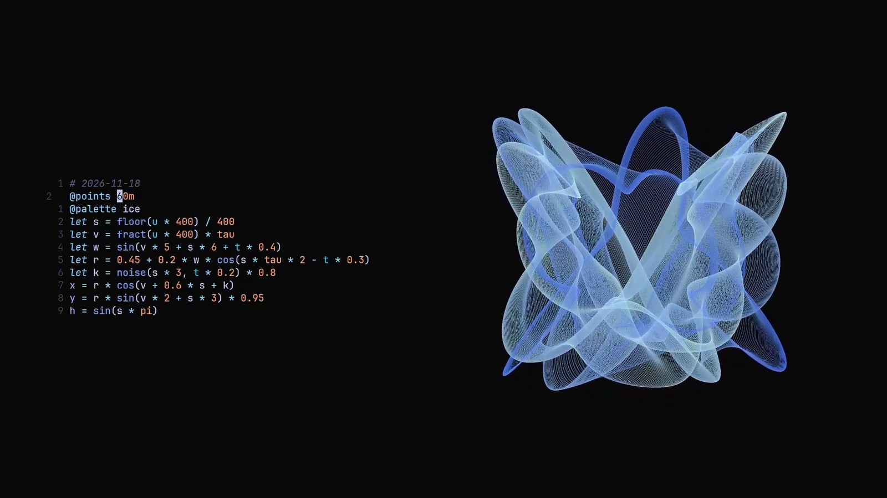
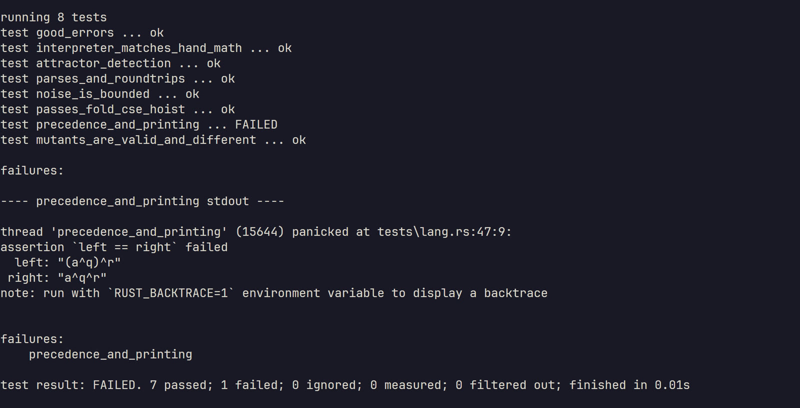
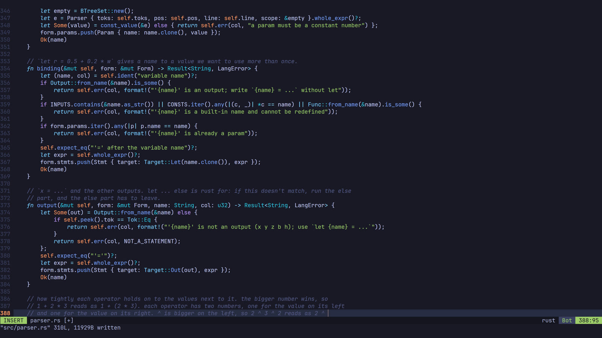
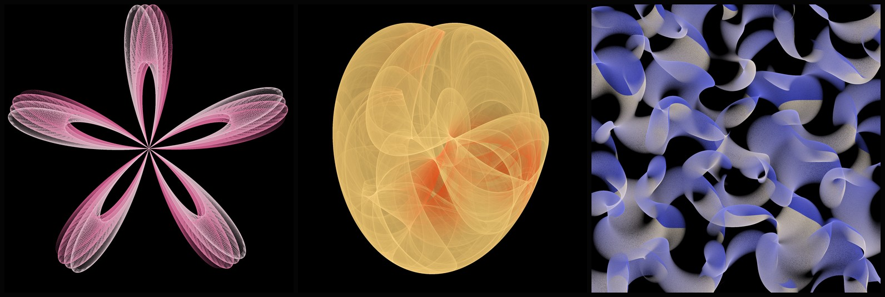
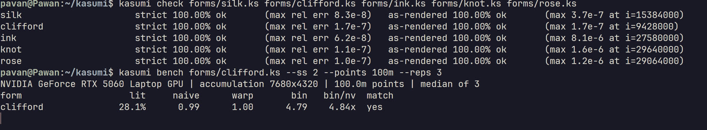
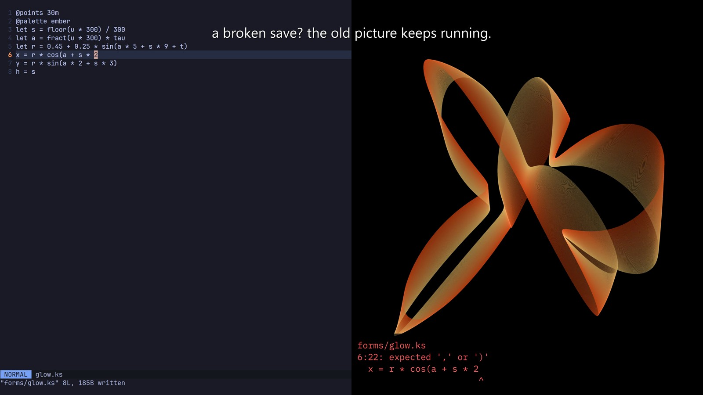
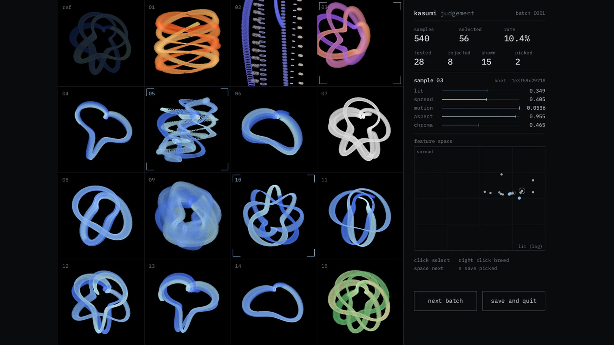
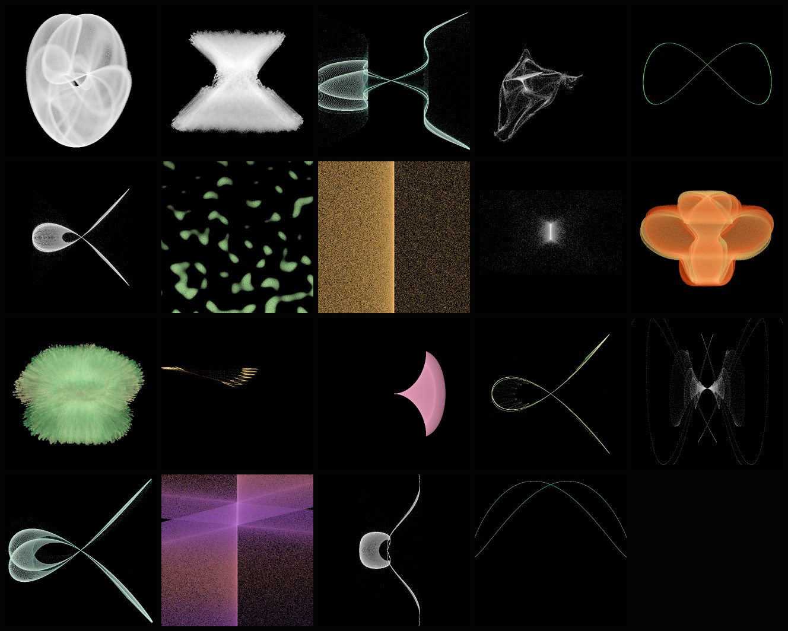

silk is twelve lines of text. point number `i` of twenty million picks one of four hundred strands, works out how far along that strand it is, and moves with a slow wave that depends on the time. kasumi turns those twelve lines into a cuda kernel, runs it once for every point, and counts how many points land on each pixel. the picture is the log of that count, which is the display trick from the fractal flame algorithm. thin threads glow where they cross instead of turning into white blobs.

it all runs on my laptop, an rtx 5060 with 26 streaming multiprocessors and 8 gb of memory. a 4k video frame can take 1.6 billion points and still renders at 13 frames a second with the encode, and saving an edited form puts the new picture on screen in about 190 ms.



## a form

```text
# silk: four hundred strands, each a slow wave, braided by time
@points 20m
@palette mono
@zoom 1.35
param strands = 400
param k = 3
let s = floor(u * strands) / strands
let v = fract(u * strands) * tau
let w = sin(v * k + s * 6 + t * 0.4)
let r = 0.5 + 0.22 * w * cos(s * tau * 2 - t * 0.3)
x = r * cos(v + 0.6 * s + 0.15 * sin(t * 0.2)) * 1.25
y = r * sin(v * 2 + s * 3) * 0.6 + 0.08 * sin(s * tau * 3 + t)
```

`u` is the point's index divided by the number of points, so it runs from 0 to 1. `floor(u * 400) / 400` cuts that range into 400 strands, and `fract(u * 400)` is the position inside one strand. `t` is the time in seconds. a form has to set `x` and `y`, and it can set `z` for depth of field, `b` for brightness and `h` for a hue between 0 and 1.

a form that reads `px` or `py`, the previous point, runs differently. each gpu thread walks its own chain, feeding every point into the next one, which is how strange attractors like clifford work.

there's no loop and no memory in the language, and every line is one statement. that's deliberate. it keeps the parser small, and every form can become one straight run of arithmetic on the gpu.

## from text to a kernel

the parser reads one line at a time. a lexer cuts the line into numbers, names and symbols, and a pratt parser builds the tree. the whole of operator precedence is this table:

```rust
Tok::Plus => (BinOp::Add, 10, 11),
Tok::Minus => (BinOp::Sub, 10, 11),
Tok::Star => (BinOp::Mul, 20, 21),
Tok::Slash => (BinOp::Div, 20, 21),
Tok::Percent => (BinOp::Mod, 20, 21),
Tok::Caret => (BinOp::Pow, 41, 40),
```

each operator has a number for how hard it holds the value on its left and one for the value on its right. `*` beats `+`, so `1 + 2 * 3` groups as `1 + (2 * 3)`. `^` holds harder on the left than on the right, which makes `2 ^ 3 ^ 2` group as `2 ^ (3 ^ 2)`. when i swapped those two numbers on purpose for a video, rustc was happy and one test failed, saying `a^q^r` had printed as `(a^q)^r`.





the error messages are written for a live editor, where you see one every few seconds. `sni(u)` gets `did you mean 'sin'?`, picked by edit distance. `2x` gets told to write `2 * x`. reading `x` before it is set, in a form that has `px`, gets told that `px` is the previous point.

the tree then becomes an ssa ir, a flat list of steps where each value is set once. every step is hashed as it's made, so writing `sin(t)` twice gives the same step back the second time. `a + b` and `b + a` are put in the same order first so they hash the same. constants fold while the list is being built, `x ^ 2` turns into `x * x`, and `x ^ 0.5` turns into `sqrt(x)`. after that a backwards walk from the outputs marks the steps that matter, and the rest is dropped.

the pass that matters most for speed is the last one. anything that doesn't depend on the point, like `sin(t * 0.4)`, gets worked out once a frame on the cpu and handed to the gpu in a small table called `U`. `kasumi ptx` shows what came out for silk:

```text
ir: 80 ast nodes -> 34 per-point ops | 0 folded, 2 cse hits, 0 dead, 5 hoisted, 6 uniform slots
  const float v2 = (fi * inv_n) * U[0];
  const float v3 = floorf(v2);
  const float v4 = v3 / U[0];
  const float v5 = ks_fract(v2);
  const float v7 = v5 * 6.2831855f;
  ...
```

`U[0]` is `strands`, a param, which is why it's read from the table and not written in as 400. a param can change without a new kernel.

codegen writes that body as cuda c++ text and pastes it into a template kernel. every name in the template has the form's number in it, so the explorer can put a whole batch of forms in one module and compile them in one call to nvrtc, nvidia's compiler that runs inside the program. a float written as `0.22` in c is a double, and doubles on this gpu are many times slower than floats. every constant goes out as `0.22f`, using rust's `{:?}` formatting so `1` always comes out as `1.0f`.

## checking every point

a wrong kernel still draws a picture, often a pretty one, so kasumi has a second implementation of the language. `interp.rs` evaluates the same ir on the cpu in 32-bit floats, with the same hash for random numbers, the same simplex noise and the same floored modulo as the cuda helpers. a probe kernel writes the raw outputs for a sample of points and `kasumi check` compares them:

```text
silk      strict 100.00% ok  (max rel err 8.3e-8)  as-rendered 100.00% ok
clifford  strict 100.00% ok  (max rel err 1.7e-7)  as-rendered 100.00% ok
ink       strict 100.00% ok  (max rel err 6.2e-8)  as-rendered 100.00% ok
```

the first time i ran it, on 10,000 sampled points of silk, the largest relative error was 8.3e-8, which is a rounding difference in the last bit.

one limit of the language comes straight out of this. `i` is a float, and floats are only exact for whole numbers up to about 16.7 million. above that two neighbouring points get the same `i`, so forms with more points use `u`, `r1` or `r2` instead.

## adding a hundred million points into one picture

every point adds a weight into one float per pixel, and colour adds a second float for the hue. that sounds like the hard part. rose is a form where every petal crosses the centre, and at 100 million points its busiest pixel gets hit 22,506 times in one frame. i planned the whole project around that kind of pile-up. the plan was tile binning, sorting points into 64 by 64 tiles and adding each tile up in fast on-chip memory, and the target was three times the speed of a plain atomic add per point.



kasumi has three ways to do the adding. naive does one `atomicAdd` per point. warp uses `__match_any_sync` to find the threads in a group of 32 that hit the same pixel, and one of them adds for all of them. tile bin counts points per tile, turns the counts into offsets, moves a packed 32-bit key for every point into its tile's part of a buffer, and has each block add one slice of a tile at a time.

at 3840 by 2160, in billions of points per second:

| form | naive | warp | tile bin |
|---|---|---|---|
| silk | 21.5 | 28.3 | 8.6 |
| rose | 15.8 | 15.3 | 5.6 |
| tiny | 27.1 | 20.9 | 6.3 |
| clifford | 6.9 | 6.8 | 5.6 |
| ink | 2.2 | 2.2 | 4.0 |

binning lost everywhere except ink, and rose, the worst case, ran at 15.8 billion with plain atomics. my guess is locality. neighbouring points on a curve land on neighbouring addresses, so the memory system sees a tidy stream even when one pixel is very hot. i haven't confirmed that with nsight compute. ink is the opposite, since nearly every point lands somewhere unrelated to the one before it.

the stage timings explain the rest. on silk the counting pass alone took 4.15 ms, and the whole naive frame took about 4.2. most of the time goes into evaluating the formula, so any method that adds passes loses. warp isn't free either. it was 32% faster on silk and 23% slower on tiny.

the first binning kernel ran the formula twice, once to count and once to place. staging the key during the count made the second pass independent of the form and took ink from 1.56 to 1.84 times naive.

then the picture got bigger. a 4k render is drawn at 7680 by 4320 and scaled down, which makes the count buffer 133 mb, and the numbers changed:

| form | naive | warp | tile bin | bin / naive |
|---|---|---|---|---|
| silk | 23.4 | 33.2 | 8.1 | 0.35 |
| rose | 12.8 | 18.7 | 6.1 | 0.48 |
| clifford | 0.92 | 0.83 | 4.52 | 4.93 |
| ink | 1.26 | 1.26 | 3.68 | 2.93 |

clifford's orbits jump all over the image. with four times as many pixels, naive fell from 6.9 to 0.92 and binning only dropped from 5.6 to 4.52. so the target was met on the forms that scatter and missed on the ones that don't. no method wins everywhere, so the live window and the renderer time all three on the current form and use the fastest. on the run in the video, clifford at that size came out 4.84 times faster with binning.



## edit to screen

the live window watches the form file. the first version took 328 ms from save to the new picture, against a target of 300. nvrtc took about 190 ms and the driver's jit about 110 more. compiling to ptx and letting the driver finish the job measured 2 to 3 times faster than asking nvrtc for finished machine code, and moving the binning kernels out of the live build and folding the warm-up loop into the main loop brought it to about 175 ms. it's about 190 now, after the rewrite further down.



a save that doesn't compile keeps the old kernel running and puts the error on the picture. while filming a video of the code going in, i noticed those error lines sat on top of each other. switching the window's text to plex mono had kept the old line spacing from an 8 pixel bitmap font, 10 pixels a line for a 12 pixel font. that fix is in the repo now.

## letting it breed

the explorer changes the syntax tree of a form at random. it nudges a constant or a param, swaps `sin` for `cos`, adds a small wave on top of a sub-expression, removes a term, or grafts in a piece of another form. most mutants are junk, and `features.rs` throws out the ones that are blank, blown out, frozen, noisy, thin, tiny, flat or cropped. what survives goes into a map-elites archive of 128 cells, keyed on how much of the frame is lit, how spread out the points are and whether the form has colour, and each cell keeps its best form.

early runs filled the archive with solid rectangles, which score well on spread and are not interesting, so there's a filter now for forms that fill their own bounding box. the seed forms also kept the novelty scores they got when they went in, so they sat at the top forever. the archive rescores everything each generation now.

## teaching it taste



`kasumi grid` shows a reference form and fifteen live mutations of it. clicking marks the ones you like, and every screen gets written down, liked or not. the panel shows what the model sees for the form under the mouse, its lit fraction, spread, motion, aspect and colour, and plots the batch in that space. the taste model is a small classifier on clip embeddings of the thumbnails.

on 540 judgements from one person, 56 of them likes, it ranks a held-out like above a skip 77.8% of the time over five random splits. holding out whole screens, it's 73%. all 540 are on two seeds, knot and rose, so those numbers say nothing about the other forms. before any real clicks existed i tested the pipeline on fake ones and it scored 98.8%, which proves the code runs and nothing else.

## eight hours, about six good forms

then i let it run overnight. in eight hours it tested 185,016 forms, threw out about 23% as junk and filled 96 of the 128 archive cells. at the end it picked 19 forms for a gallery page.



about six of them are good. there are half-frame stripes, a field of noise, slivers, a lone figure eight. a few things went wrong together. the taste model had only ever seen knot and rose, so on everything else it was guessing. the junk filter ran before the taste model, so the model never saw what bad looks like. novelty was about 44% of the score, which pays for being strange. the style cells made room for sparse forms whether they were good or not. and full-frame forms like the orange stripes got through a hole in the cropping filter.

the gallery that went up has 24 forms, picked by eye from 549 distinct ones.


## making it smaller

kasumi started as four crates, a language, a gpu engine, an explorer and a command line. once it worked i folded them into one, moved the kernels out of rust strings into `.cu` files, and generated each kernel's argument struct for both rust and cuda from a single declaration. 6,970 lines became 5,759. i wanted 4,000, and going further meant taking features out.

none of that was allowed to change a single output. the interpreter's numbers for 555 forms came out byte-identical, 11.3 mb of them. 42 renders matched the old build to within one level out of 255, which is atomic adds landing in a different order. speed was within 7% on every form and 0.4% faster on average.

## what's still missing

scatter on ink touches about 1,000 of the 8,160 tiles in each round of 1,024 points, so its writes can't merge. it needs coarser buckets and a second sort, and i haven't built that. the taste model has been trained on two seeds and one person. kasumi has only been tested on windows 11. and the gallery still needs a person looking at it.

the forms are at [cintu07.github.io/kasumi](https://cintu07.github.io/kasumi/), each with its formula, and the code is on [github](https://github.com/Cintu07/kasumi).
