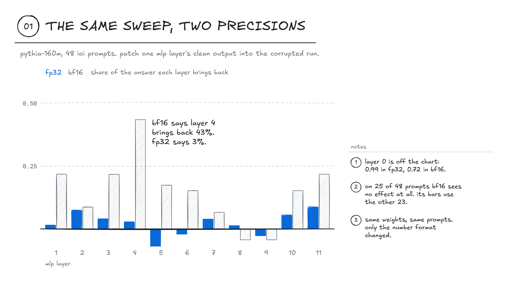
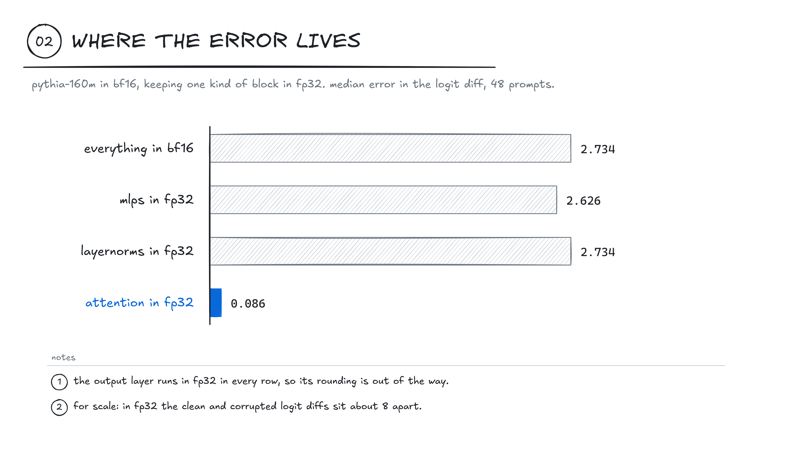
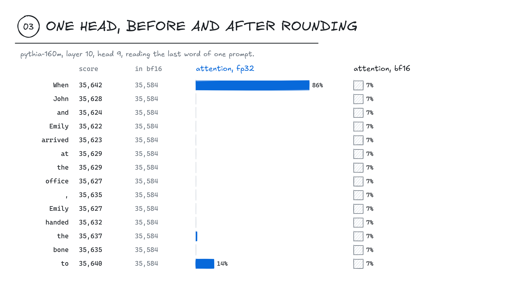
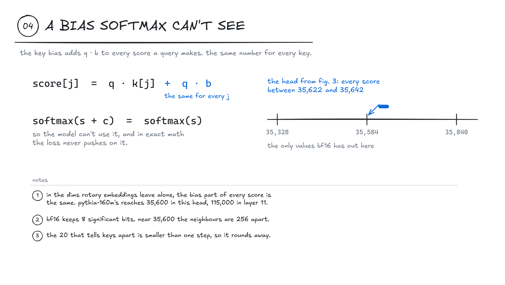
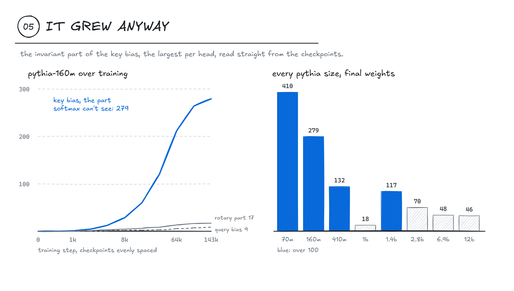
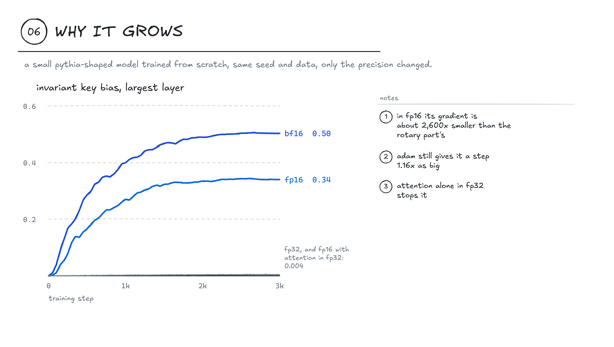
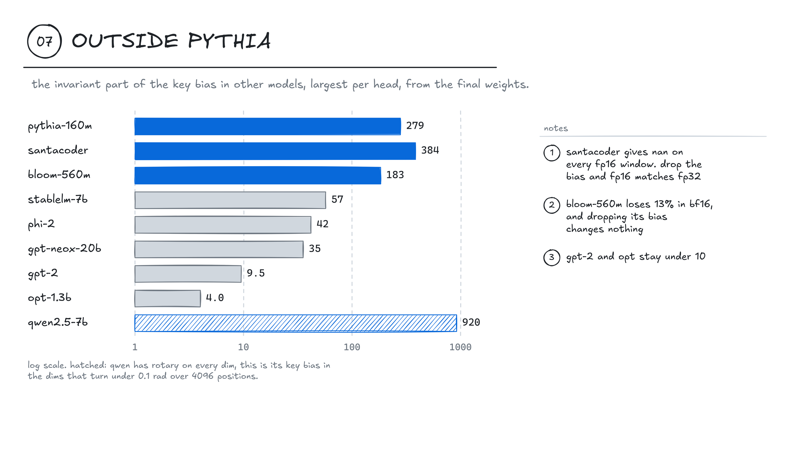
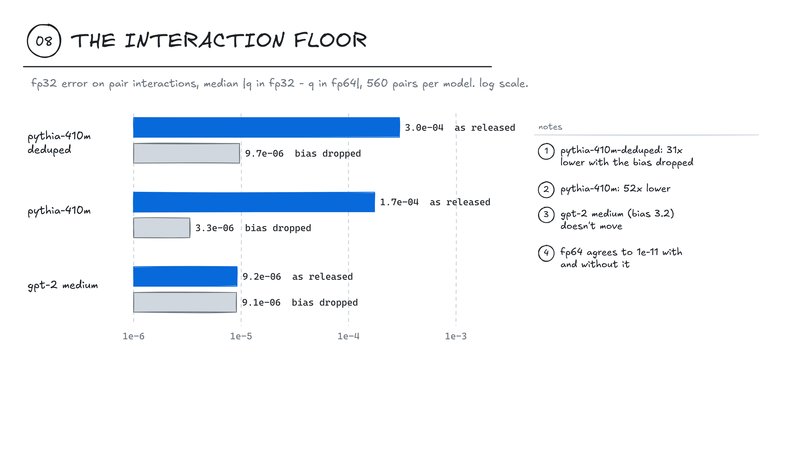

i ran the same activation patching sweep on pythia-160m twice, once in fp32 and once in bf16. same weights, same 48 prompts. fp32 said mlp layer 4 brings back 3% of the answer. bf16 said 43%.

on 25 of the 48 prompts bf16 saw no effect at all. the clean run and the corrupted run came out with the same logit diff, and a patch can't bring back a difference that isn't there.

[github.com/Cintu07/kerneltrace](https://github.com/Cintu07/kerneltrace) has the code and every number below. it's a tool i've been building that makes you write an interpretability claim down before you measure it, and then tries to break it. rerunning the experiment in another number format is one of the ways it attacks a claim.



## the setup

the task is indirect object identification. in "When John and Emily arrived at the office, John handed the bone to", the model should say Emily. the corrupted prompt swaps the second John for Emily, which pushes the model toward John. the number i track is the logit diff, the logit for Emily minus the logit for John at the last position.

patching takes one mlp layer's output from the clean run and puts it into the corrupted run, and if the logit diff comes most of the way back, that layer is carrying the answer. in fp32, layer 0 brings back 0.99 of it and no other layer gets past 0.09.

## first suspect, the output

pythia-160m's logits for these names sit near 836. bf16 keeps only 8 significant bits, and between 512 and 1024 that leaves it every fourth number and nothing in between. a logit diff of 5 comes out as 4, 8 or 0. that looked like the zeros.

gpt-2 small has a milder version of the same thing. its logits sit around 80, where bf16 steps by 0.5. one prompt gave -1.5 run alone and -1.0 as one row in a batch of 15 copies of itself. fp32 gave -1.2814 both ways. doing only the last matmul, the unembedding, in fp32 got that to -1.2537 and -1.2168, and took gpt-2's median patching error from 0.027 to 0.006. i wrote about the same kind of batch-shape rounding in [speculative decoding](/posts/batch-invariance/).

on pythia it made things worse. the median patching error went from 0.10 to 0.46, which meant the output grid was only a small part of whatever was going on.

## the error is in attention

i kept one kind of block in fp32 at a time and left the rest in bf16, with the unembedding in fp32 in every run.



keeping the mlps or the layernorms in fp32 barely moved it. attention in fp32 took the median error in the logit diff from 2.73 to 0.086.

the scores were huge. from layer 3 on, the biggest score a query gave any key was in the thousands, and in layer 11 it was 115,448. but the scores barely differed between keys. in that layer, the worst head's scores for one query spread over 86 across all the keys it could see. bf16 steps by 512 at that size.

## one head



head 9 in layer 10, reading the last word. every score is between 35,622 and 35,642, and in fp32 the head puts 86% of its attention on "When". round the scores to bf16 and all fourteen become 35,584. softmax over fourteen equal numbers gives 7% to each word.

## where the offset comes from



it's the key bias. a head builds the key for token j as W·x + b, so the score of that key is q·(W·x) + q·b. the second term has no j in it. every key gets the same q·b, and softmax of s + c is the same as softmax of s. the term has no effect on the attention pattern. this part isn't new, namazifar and others pointed out in 2023 that the key bias is redundant for exactly this reason.

pythia applies rotary embeddings to the first quarter of each head's dimensions. rotary turns the bias by position there, and that quarter does reach the attention pattern. in the other three quarters the bias is the same for every key. in pythia-160m that part of the bias has a norm of up to 279. the part rotary touches stays under 20. the query bias stays under 9.

## it grew anyway



a term that softmax cancels gets no gradient from the loss, at least in exact math. it was 0 at step 0, 1.0 at step 1,000, 28 at 8,000, 120 at 32,000 and 279 at the end, step 143,000.

pythia's training checkpoints are published as separate branches. a safetensors file starts with a json header that says where each tensor sits. with http range requests i read only the 12 bias tensors out of each checkpoint, a few kilobytes each. the same reader went through the final weights of every pythia size, up to 12b. 70m, 160m, 410m and 1.4b are over 100. 1b is at 18, and its bf16 numbers were fine all along.

## why it grows

my first guess was adam. later i found that the cerebras-gpt paper had already seen key biases grow during fp16 training, back in 2023, and put it down to underflow in the softmax gradients. they never tested it. so i did.



i trained a small pythia-shaped model from scratch, 4 layers with rotary on a quarter of each head, the same seed and the same data every time, and only changed the precision. after 3,000 steps the invariant part is 0.004 in fp32, 0.34 in fp16 and 0.50 in bf16. the loss curves match to three decimals, so the three models learn the same thing.

the gradient of that part is the sum of the softmax score gradient over the keys, times q. in exact math the sum is zero. in fp16 the score gradient gets rounded before the matmul, the sum stops being zero, and the invariant part gets a gradient about 2,600 times smaller than the rotary part's. adam divides every step by the gradient's own recent size, so the rotary part and the invariant part end up taking steps of about the same size anyway, 1.16 to 1. in fp32 the gradient is 800 times smaller again, it falls under adam's epsilon, and the step is close to zero.

keeping only attention in fp32 and everything else in fp16 stops it, 0.004, same as full fp32. so does a large adam epsilon, but that also slows every other small weight down. what i still don't know is where the sign of the rounding error comes from, and what 143,000 steps would do in the small model.

## it isn't only patching

perplexity on the start of the wikitext-2 test set, 64 windows of 512 tokens, as a change from fp32.

| model | bf16 | fp16 | bf16, bias dropped | fp16, bias dropped | bf16, fp32 attention and head |
|---|---|---|---|---|---|
| gpt-2 small | +1.0% | +0.0% | +0.9% | +0.0% | -0.2% |
| pythia-70m | +870% | nan | +396% | +3.1% | +0.6% |
| pythia-160m | +171% | nan | +61% | +0.8% | +0.3% |
| pythia-410m | +19.6% | nan | +0.1% | +0.0% | +0.0% |
| pythia-1b | +0.0% | +0.0% | +0.0% | +0.0% | +0.0% |
| pythia-1.4b | +5.7% | nan | +2.1% | nan | +0.4% |

pythia-70m goes from 68 to 659 in bf16. in fp16, four of the five pythia sizes i ran give nan on every window, because numbers inside their attention pass 65,504, the largest one fp16 has.

## deleting it

so i deleted it.

```python
from kerneltrace.models.precision import drop_invariant_key_bias
drop_invariant_key_bias(adapter)  # zeroes the key bias outside the rotary dims
```

in fp32 the logits move by at most 0.007 after this. fp32 drifts about that much on its own when the batch size changes. pythia-410m then runs in plain bf16 within 0.1% of fp32 perplexity and stops giving nan in fp16. its patching sweep lands within a median of 0.007 of fp32, with the same top three layers.

it doesn't fix everything. 70m and 160m still need the unembedding in fp32, because their logits still sit near 836. 1.4b still overflows fp16, because the attention code multiplies q by k before it scales, and that raw product reaches 129,160 even with the bias gone. keeping attention and the unembedding in fp32 works on all six models, within 0.6% of fp32 perplexity. it costs more memory than deleting a bias does.

i also reran the patching audit on a second task, capital cities. "the capital of france is the city of", corrupted by swapping the country. recall leans on mlps where ioi leans on attention, so it's a different circuit. pythia-410m's bf16 error is 0.024 there, and 0.002 with the bias dropped. 160m needs the drop and the fp32 unembedding together, because its capital logits sit near 830, where bf16 steps by 4.

## outside pythia

any model with a key bias has this part. with learned positions or alibi it's the whole key bias, and with partial rotary it's the dims rotary skips. i read it out of 23 more checkpoints from eight families.



santacoder's is 384 and bloom-560m's is 183, against query biases of 7 and 11. phi, stablelm-7b and gpt-neox-20b sit between 27 and 57. gpt-2 and opt stay under 10, and gpt-2 medium, large and xl are below their own query bias. it doesn't happen everywhere.

qwen2.5 has rotary on every dim, so none of its key bias is exactly invariant. but its rotary base is a million, and its slowest dims barely turn across 4,096 positions. that's where its key bias lives, 920 in the 7b against 120 in every other dim. zeroing it there moves the fp32 logits by 0.18 and perplexity by under 0.01%.

a big bias doesn't always break anything. santacoder gives nan on every fp16 window, and with the invariant part dropped its fp16 perplexity matches fp32. but its bf16 is only 0.1% off. its raw q times k reaches 148,785, more than twice fp16's 65,504, and with the bias dropped it peaks at 1,579. bloom-560m loses 13% in bf16, and dropping its bias changes nothing. that one turned out to be its logits, which sit near 430 where bf16 steps by 2. computing only the unembedding in fp32 takes it to 0.6%. qwen and opt are fine in both.

## interactions

baligar (2026) measured something one step past single patches: pair interactions. you patch two places, each alone and then both, and q = f11 - f10 - f01 + f00 is what the two do together that they don't do apart. the four terms are all near 1 and q is small, so rounding in any of them lands in q whole. that paper ran it in fp32 and fp64 on gpt-2 medium and pythia-410m-deduped, found pythia's fp32 error ten times gpt-2's, and didn't say why.

pythia-410m carries an invariant key bias of 132, so i reran that measurement on ioi with and without it. residual stream patches at 4 depths and 2 positions, 28 pairs per prompt, 20 prompts, 560 pairs per model, every run in fp64, fp32 and bf16. the fp64 run keeps softmax and rotary in fp64 too, since the library casts both to fp32 for pythia.



on pythia-410m-deduped, the model that paper used, the fp32 floor goes from 3.0e-4 to 9.7e-6 with the bias dropped. on pythia-410m it goes from 1.7e-4 to 3.3e-6. gpt-2 medium sits at 9.2e-6 either way. with the bias gone both pythias land at or under gpt-2 medium, and in fp64 the two versions of each model agree to 1e-11, so what the model computes didn't change. the tenfold gap between the two models was this bias, measured on the same pairs.

bf16 is worse in a way the bias doesn't explain. its error on these pairs is 0.06 to 1.4, about the size of the interactions, and on 410m-deduped 71% of pairs have an error bigger than the interaction. dropping the bias gets that to 46%. i wouldn't read an interaction in bf16 on any of these three models.

## what i got wrong

i committed predictions to the repo before each batch of runs. 31 of the 52 held. i had guessed pythia's bf16 batch jumps would be bigger than gpt-2's. on most prompts neither model jumped at all, and fewer pythia-160m prompts moved than gpt-2 prompts, 5 against 12, because a grid of 4 swallows small drift until it lets go in a step of 4 or 8. the fp32 unembedding was supposed to fix pythia. it didn't. i also thought 160m's 25 lost prompts would stay lost after deleting the bias, but all 25 came back. in the training runs i expected the invariant part to overtake the rotary part within 3,000 steps, and it ended at 0.34 against 4.04. and outside pythia i expected the growth to be more common and to do more damage than it did. in the last batch i guessed bloom's offsets didn't come from its bias, and they did. i guessed rewriting its alibi would fix its bf16, and it didn't, which is how i found the logits. the other misses are in `experiments/` next to the results.

the patching results are two tasks on pythia and gpt-2, and the interaction runs are one task on three models. the training runs are a 4-layer model for 3,000 steps. the survey reads 9 families from their weights and runs perplexity on 6 of them.
