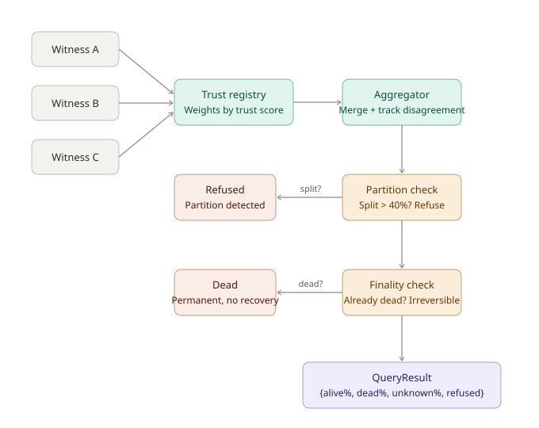

a failure detector has to answer one question, whether a node is alive, and the usual way to answer it is a timeout. you send a ping, nothing comes back in time, and the node is marked dead. that's often wrong. the node might be stuck in a gc pause, the network might be slow for a few seconds, or the machine might be so busy that it answers late. the detector can't tell these apart from a crash, so it guesses, and everything downstream treats the guess as a fact.

guessing dead when the node is alive is the expensive mistake. the cluster splits and failover starts, and some of that is hard to undo.

styx is the membership system i wrote to stop guessing. ask it whether a node is alive and it answers with a distribution, something like alive 61%, dead 19%, unknown 20%. when it doesn't have enough to go on, most of the weight sits on unknown. when different parts of the cluster see different things, which is what a network partition looks like, it refuses to answer at all.



## two failures that look the same

from the outside, a node that has died and a node that can't be reached right now look identical. the process might have crashed or the disk died. or the network path is congested, the process is paused, or the cpu is saturated and probes are answered too late.

the two need opposite responses. a dead node should be routed around and recovered. an unreachable one should be waited for. treat the second like the first and you start recovery nobody needed, push extra load onto the rest of the cluster, and sometimes cause the outage you were trying to detect.

so styx treats a timeout as evidence, and weak evidence at that. how weak depends on how long it waited, whether its own machine was struggling at the time, and whether other nodes saw the same thing.

## a distribution instead of a boolean

every node gets three numbers that add up to one.

```go
type Belief struct {
    alive   Confidence
    dead    Confidence
    unknown Confidence
}
```

`Confidence` is a float64 between 0 and 1, and the constructor checks the sum before it accepts anything.

```go
func NewBelief(alive, dead, unknown float64) (Belief, error) {
    sum := alive + dead + unknown
    if math.Abs(sum-1.0) > BeliefSumEpsilon {
        return Belief{}, fmt.Errorf("%w: got %f", ErrBeliefInvalidSum, sum)
    }
    // ...
}
```

checking it at construction means nothing later can be handed a broken distribution. a node starts at `{0, 0, 1}`, completely unknown, before any evidence comes in.

three rules sit on top. no node ever reaches `{1, 0, 0}` or `{0, 1, 0}`, because evidence alone can take it to 90% at most. unknown never drops below 5%. and evidence that conflicts makes unknown bigger instead of being averaged away. the 90% cap is there because certainty is rare and expensive in a distributed system, and the 5% floor covers the failures the model doesn't know about yet. if the system is going to be cautious about anything, it should be cautious about claiming to be sure.

## not all evidence weighs the same

styx collects six kinds of evidence.

```go
const (
    KindDirectResponse    EvidenceKind = iota
    KindTimeout
    KindWitnessReport
    KindCausalEvent
    KindSchedulingJitter
    KindNetworkInstability
)
```

a direct response is the strongest. you sent a probe and got an answer, so the node was alive at that moment. its weight starts at 1.0 and drops if the answer was slow, down to 0.6 for a 1500 ms response, because a slow answer says something is degraded.

a timeout is the weakest, and the code says so.

```go
// Per Property 4 and 15: timeouts are WEAK evidence, never proof of death.
func NewTimeout(...) Evidence {
    ratio := float64(waitedMS) / float64(expectedMS)
    weight := 0.1
    if ratio > 10.0 {
        weight = 0.3 // Still weak - silence != death
    }
    // ...
}
```

even after waiting ten times longer than expected, a timeout weighs 0.3. one of them can't get dead confidence anywhere near the 85% needed to declare death. several timeouts from several witnesses might, eventually.

a causal event is the other strong signal. if the node produced something that only that process could have produced, it was alive at that logical time, and the weight is always 1.0.

scheduling jitter and network instability don't say anything about the target. they say the local machine was in a bad state, so its other evidence should count for less.

## when the observer is the problem

a timeout can be wrong for reasons that have nothing to do with the node being checked. if the machine sending the probe is busy, in a gc pause, or running hot, the probe might go out late, or the reply might sit in a queue while the thread that should read it is paused.

styx measures its own scheduling jitter and uses it to discount timeouts.

```go
func (jt *JitterTracker) GetJitterFactor() float64 {
    // ...
    if maxJitter > 2.0 {
        return 0.1 // Extreme jitter event detected
    }
    if mean > 0.5 {
        return 0.2 // Sustained high jitter
    }
    if mean > 0.2 {
        return 0.5 // Moderate jitter
    }
    return 1.0 - (mean * 2.5)
}
```

every timeout's weight gets multiplied by that factor before it is recorded, and capped at 0.3 either way.

```go
ev = evidence.NewTimeout(ts, expectedMS, actualDuration.Milliseconds(), source, target)
ev.Weight *= jitterFactor
// Cap at 0.3 regardless
if ev.Weight > 0.3 {
    ev.Weight = 0.3
}
```

so a timeout seen while the local machine was struggling counts for almost nothing. in plain words the detector is saying that it didn't get an answer, but its own machine was misbehaving at the time, so it can't blame the other node. this matters because the two problems tend to arrive together. a machine loaded enough to time out its probes is usually loaded enough to have jitter, and a naive detector reads both as the target failing.

## old evidence fades

an answer from three minutes ago says less about now than an answer from three seconds ago.

```go
func (e Evidence) EffectiveWeight(now styxtime.LogicalTimestamp, halfLife uint64) float64 {
    age := e.Timestamp.AgeSince(now)
    decayFactor := pow(0.5, float64(age)/float64(halfLife))
    return e.Weight * decayFactor
}
```

the default half-life is 100 logical time units, so evidence twice that old keeps a quarter of its weight. when a node stops answering, its old "alive" evidence fades, and unknown slowly comes back up. without the decay, a partitioned node would look alive forever on the strength of answers it gave before the split.

## logical time instead of wall clocks

wall clocks can't be trusted across machines. ntp can step backwards, virtual machines drift, and a machine that froze can wake up with a time that is hours behind everyone else.

styx uses lamport timestamps everywhere.

```go
// Lamport's rule: ts = max(local_ts, received_ts) + 1
func (t *LogicalTimestamp) Update(received LogicalTimestamp) LogicalTimestamp {
    if received > *t {
        *t = received
    }
    t.Increment()
    return *t
}
```

if event a caused event b, then `ts(a) < ts(b)`, and no clocks need to agree for that to hold. the decay runs on these timestamps, so "old" means many events ago. you can't turn that into minutes for a person to read, but for deciding how much an old answer should count, events-ago is the right measure.

## many witnesses

no single node sees everything, so styx combines reports from witnesses, other nodes saying what they can see.

```go
type WitnessReport struct {
    Witness types.NodeID
    Target  types.NodeID
    Belief  types.Belief
    Trust   TrustScore
}
```

combining them is more than an average, for two reasons. when witnesses disagree, the disagreement is information. five witnesses at 90% alive is a clear picture. three at 90% alive and two at 85% dead means something odd is going on, and styx moves weight into unknown instead of averaging the numbers into a confident-looking middle.

```go
if disagreement > 0.3 {
    reduction := disagreement * 0.5
    avgAlive *= (1 - reduction)
    avgDead *= (1 - reduction)
    avgUnknown = 1.0 - avgAlive - avgDead
}
```

and witnesses that say exactly the same thing aren't independent. ten identical reports might be one view of the cluster copied ten times, so highly correlated witnesses have their combined confidence cut by 30%.

## trust

some witnesses are right more often than others, so each one carries a trust score.

```go
const (
    MaxTrust     TrustScore = 1.0
    MinTrust     TrustScore = 0.1
    DefaultTrust TrustScore = 0.8
    DecayRate               = 0.1
    RecoveryRate            = 0.05
)
```

trust falls faster than it recovers, 0.1 for a wrong report and 0.05 for a right one, so it takes two good reports to make up for one bad one. it never goes below 0.1, which keeps even a poor witness slightly in the picture. reports are weighted by trust when they are combined.

## partitions

in a partition, groups of nodes see different worlds. group a can reach node x but not y, and group b can reach y but not x. "is x alive?" has no single answer, because it depends on which side you ask from.

styx looks for that shape and refuses.

```go
func (d *Detector) Analyze(reports []witness.WitnessReport, target types.NodeID) (PartitionState, *SplitReality) {
    // ...
    if aliveVotes > 0 && deadVotes > 0 {
        disagreement := float64(min(aliveVotes, deadVotes)) / float64(total)
        if disagreement > d.disagreementThreshold { // 0.4
            d.state = ConfirmedPartition
            // return SplitReality showing both groups
        }
        d.state = SuspectedPartition
    }
}
```

if more than 40% of the witnesses hold the minority view, the partition counts as confirmed, and the answer comes back with `refused: true` and the reason "network partition detected - witnesses disagree". averaging the two camps would give a 50/50 answer that looks like ordinary uncertainty and hides the fact that the cluster is split. a refusal says what is actually going on, and a caller can handle "i won't answer" differently from "50% alive".

## death is final

once styx declares a node dead, it stays dead. if the process comes back, it has to rejoin with a new identity, the same base id with the generation counter bumped.

```go
func (n NodeID) Rebirth() NodeID {
    return NodeID{
        Base:       n.Base,
        Generation: n.Generation + 1,
    }
}
```

that rules out zombies. a node that was declared dead and then came back is a different node as far as the system is concerned, and the generation number tells the two apart.

declaring death has a high bar.

```go
const (
    MinDeadConfidence     = 0.85
    MinWitnesses          = 3
    MaxDisagreement       = 0.2
    MinNonTimeoutEvidence = 0.3
)
```

85% dead confidence, at least three witnesses, little disagreement, and at least 30% of the evidence coming from something other than timeouts. the last one matters most. three witnesses that all heard nothing are still only reporting silence, and styx wants some positive sign that the node is unresponsive before it will call it dead.

there's no way to undo it either.

```go
func (e *Engine) AttemptResurrection(id types.NodeID) error {
    if _, exists := e.dead[id]; exists {
        return ErrResurrection
    }
    return nil
}
```

## asking it

the oracle is the part you talk to. `Query(target)` returns this.

```go
type QueryResult struct {
    Target         types.NodeID
    Belief         types.Belief
    Refused        bool
    RefusalReason  string
    Dead           bool
    WitnessCount   int
    Disagreement   float64
    PartitionState partition.PartitionState
    Evidence       []string
}
```

a query checks whether the node is already dead, then whether answering would hide a partition, then combines the reports, then checks the confidence. the `Evidence` field lists what went into the answer in plain words, like "aggregated 7 witness reports" or "finality: node declared dead", which helps a lot when you're trying to work out why it said what it said.

`QueryWithRequirement` takes a minimum confidence.

```go
var StrictRequirement = RequiredConfidence{
    MinAlive:   0.7,
    MinDead:    0.7,
    MaxUnknown: 0.3,
}
```

if the belief doesn't meet it, the oracle refuses instead of returning a weak answer, and the caller picks how strict to be based on what it's about to do with the result. there's also `MustQuery`, which panics on a refusal. its comment says "USE WITH CAUTION - defeats the purpose of STYX", and it's there for code that really can't handle "i don't know" and has to opt into the risk out loud.

## over http

the server has five endpoints.

- `GET /query?target=ID` returns a node's status
- `POST /report` takes a witness's belief about a node
- `POST /witnesses` registers a witness
- `GET /health` is a health check
- `GET /metrics` serves prometheus counters

a query comes back like this.

```json
{
  "target": 42,
  "alive_confidence": 0.61,
  "dead_confidence": 0.19,
  "unknown": 0.20,
  "refused": false,
  "dead": false,
  "witness_count": 4,
  "disagreement": 0.08,
  "partition_state": "NO_PARTITION",
  "evidence": ["aggregated 4 witness reports"]
}
```

and a report goes in like this.

```json
{
  "witness": 10,
  "target": 42,
  "alive": 0.8,
  "dead": 0.1,
  "unknown": 0.1
}
```

a report whose numbers don't add up to one gets a 400 with the reason.

## the tla+ spec

`formal/Styx.tla` models the core rules.

```
THEOREM Spec => []Property7_BeliefNeverBinary
THEOREM Spec => []Property18_ConfidenceSumsToOne
THEOREM Spec => []Property13_FalseDeathForbidden
THEOREM Spec => Property14_FinalityIrreversible
```

the model is simpler than the code. `UpdateBeliefs` sets a fixed distribution instead of doing the real aggregation, so the spec proves the structural rules but would miss a bug in the maths. it's a way to reason about the invariants, not a proof that all of it is correct.

## what isn't there yet

there's only one oracle. several oracles agreeing on a death would need something like paxos or raft, and that's a separate, harder problem.

nothing is persisted. if the oracle restarts, it starts from zero evidence, which is correct in a way, since after a restart it really doesn't know anything, but it means it takes a while to be useful again.

the prober has a `Probe` method but no way to send a probe of its own. you inject a `ProbeFunc`, which keeps the core independent of any transport and means you wire that part up yourself. there's also no transport between nodes. reports come in over http, so a real deployment needs a small gossip loop on each node that sends what it can see to the oracle, maybe two or three hundred lines that i haven't written.

the economics module in `economics/economics.go` lets witnesses stake tokens and get slashed for wrong reports, as a defence against lying witnesses. it isn't connected to the oracle, and it would need a token system that doesn't exist. the bft aggregator with ed25519 signatures is written too, but it sits next to the simpler aggregator instead of being used by it.

the oracle and the evidence code work. the gap between them and the spec is the aggregation maths, the jitter discount and the decay, and that's where i'd expect the bugs to be if any turn up.
